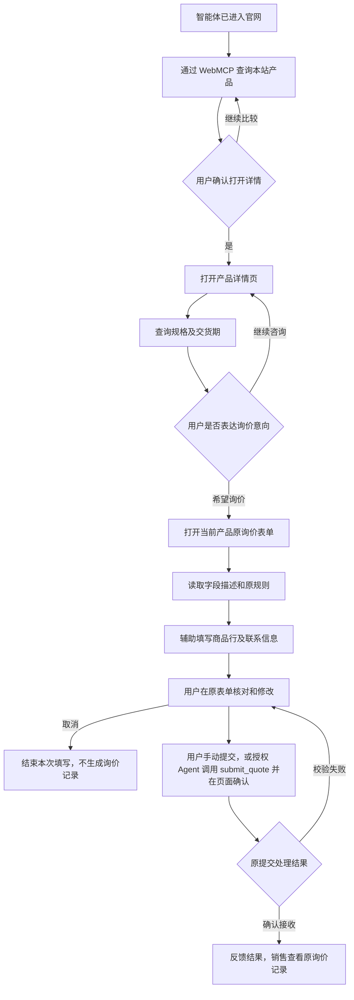
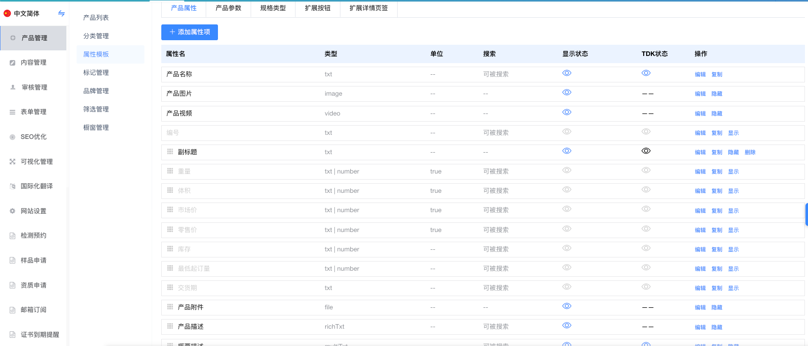
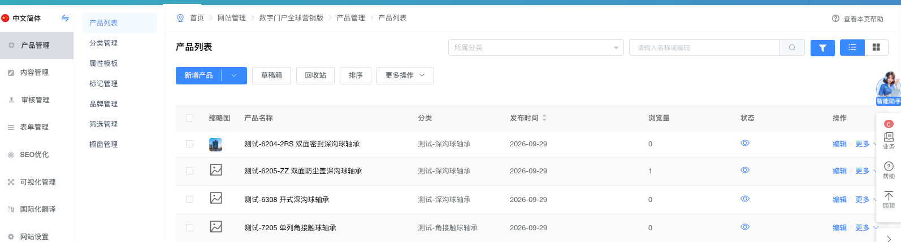
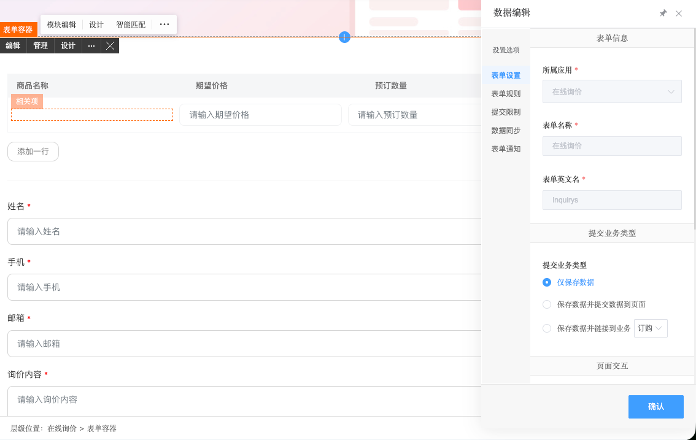
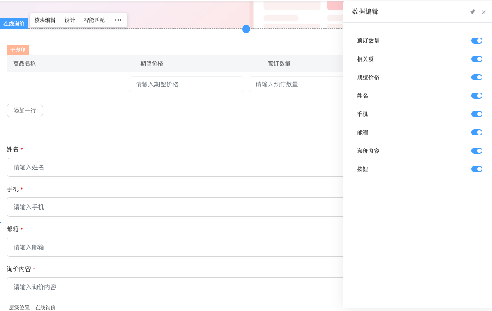
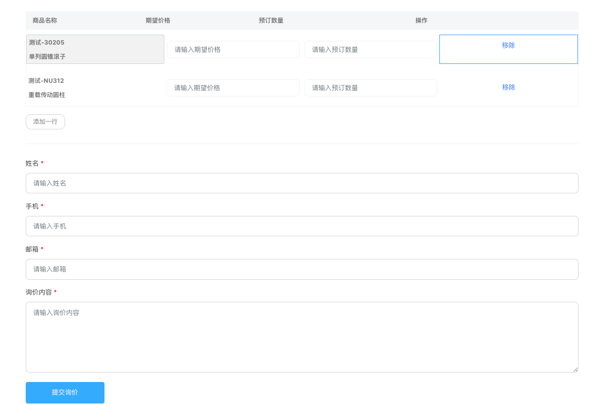
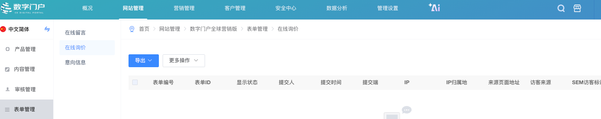

# WebMCP 产品咨询与询价产品设计

- 版本：v0.22
- 日期：2026-10-26
- 适用产品：企业网站中台

## 目录

1. [背景](#background)
2. [产品目标与边界](#objectives)
3. [用户角色与业务职责](#roles)
4. [完整业务流程](#journey)
5. [产品功能升级点](#upgrades)
6. [通用配置与生效规则](#common)
7. [具体改动功能](#pages)
8. [异常说明](#exceptions)
9. [WebMCP 工具清单与字段定义](#tools)
10. [示例说明](#examples)
11. [参考 HTML 与产品文档对应关系](#references)

<a id="background"></a>

## 1. 背景

企业网站已有产品管理、产品属性模板、产品详情页及在线询价表单。前期知识库场景已将产品资料整理为结构化数据，这份数据后续由独立的产品数据 MCP 对外提供查询服务。产品详情引用后台产品数据，询价表单支持商品明细、联系信息、需求填写和提交，销售在后台接收询价记录。

采购用户通过智能体访问官网时，需要先咨询产品，再决定是否询价。中台需要把现有产品资料和表单操作提供为页面工具，使智能体能够读取产品信息、理解表单字段、辅助填写；用户核对并确认后，智能体也能调用原提交流程并取得回执。

后台产品结构化数据 MCP 提供查询、筛选、聚合；页面 WebMCP 提供本站产品查找，并使用当前产品和表单上下文，完成官网内的咨询与询价衔接。两者共享已有数据，各自承担对应职责。

<a id="objectives"></a>

## 2. 产品目标与边界

### 2.1 产品目标

| 目标 | 达成表现 |
|---|---|
| 完成官网咨询到询价 | 用户从咨询产品开始，最终在现有表单提交有效询价 |
| 运营少配置 | 属性模板的 WebMCP 区只设总开关和工具用途；字段是否可查询在现有属性项中设置；表单描述默认读取字段名和占位文字 |
| 复用已有业务 | 原产品维护、表单填写、校验、提交和销售接收继续使用 |
| 支持多行业、多企业 | 工具由各站实际产品属性及表单定义生成，不要求统一业务字段编码 |

### 2.2 业务边界

流程起点是智能体已经找到并进入官网，终点是现有系统接收询价、页面反馈实际结果。功能覆盖本站产品查找、确认后的站内页面跳转、产品属性的 WebMCP 配置、产品详情查询和表单 WebMCP 适配。网站制作中的改动集中在 form 表单的 WebMCP 开关和字段描述。网站发现与理解层不在本需求中。

交期查询读取当前产品的交货期属性。表单使用已设计好的页面和规则；用户可手动提交，或明确授权 Agent 调用提交工具。工具提交前还须在页面上由用户确认。

### 2.3 与后台产品数据 MCP 的边界

| 比较项 | 后台产品数据 MCP | 页面 WebMCP |
|---|---|---|
| 核心用途 | 产品数据查询、筛选、聚合 | 本站产品查找、站内导航、当前产品咨询及表单操作 |
| 产品范围 | 按接口和调用者授权查询数据集 | 查找本站已开放产品；详情查询按当前页面绑定的产品读取 |
| 当前产品、规格 | 调用方提供查询条件 | 使用页面已有上下文 |
| 数据与字段定义 | 共享产品数据和属性定义 | 引用同一份数据和定义 |
| 交货期 | 按 MCP 权限查询产品字段 | 按 WebMCP 开放配置读取当前产品字段 |
| 询价表单 | 不负责页面控件和填写状态 | 读取字段、填入原控件；用户确认后调用原提交处理并返回结果 |
| 权限 | MCP 调用者授权 | 当前网站访问者权限与页面字段开放配置 |
| 页面关闭 | 可按独立授权继续访问 | 对应页面工具不可继续使用 |

产品查找可复用后台产品查询服务，但 WebMCP 只提供本站当前访客有权访问、已开放的产品结果；不要求买家先连接后台 MCP。后台聚合、跨数据集分析等能力仍由产品数据 MCP 承担。

产品事实维护一份，渠道开放分别控制。WebMCP 字段关闭后，工具不得通过后台 MCP 或旧缓存补回该值。关闭 WebMCP 不影响独立 MCP 的授权；买家未连接后台 MCP，也能在支持 WebMCP 的官网页面使用本流程。

<a id="roles"></a>

## 3. 用户角色与业务职责

| 角色 | 要完成的任务 | 产品提供的支持 |
|---|---|---|
| 网站运营人员 | 在属性模板开启 WebMCP，维护原产品资料，在网站制作中配置 form 表单 | 复用现有属性设置、产品详情继承配置、表单描述自动生成 |
| 采购用户 | 咨询产品，选择询价商品，提供需求并核对提交 | 产品资料查询、信息缺失提示、原表单查看与修改、手动或授权提交、实际回执 |
| 买家 Agent | 调用产品查询工具，理解表单字段，收集缺失信息、辅助填写并在授权后提交 | 清晰的工具用途、字段描述、原校验规则及执行结果 |

<a id="journey"></a>

## 4. 完整业务流程

### 4.1 前台页面与动作



### 4.2 每个阶段的页面职责

| 阶段 | 页面及上下文 | 智能体使用的能力 | 完成条件 |
|---|---|---|---|
| 定位产品 | 官网首页、分类或产品列表 | search_products：查询本站有哪些产品，或按关键词查找 | 返回候选产品及详情链接，先向用户介绍候选 |
| 打开详情 | 同一产品列表 | open_product_detail：用户确认后按候选产品标识打开原详情页 | 页面切换到选定产品详情，不把查询当作自动跳转 |
| 产品咨询 | 当前产品详情 | get_product_spec | 根据已开放资料回答规格、标准等问题 |
| 交期咨询 | 同一产品详情 | check_lead_time | 返回原交货期，或说明暂未提供 |
| 转入询价 | 产品详情的原询价按钮或入口 | open_inquiry_form：用户表达询价意向后打开原表单；继续沿用 form 子表“相关项”产品绑定 | 当前产品进入原询价表单，尚未填写或提交 |
| 理解并填写 | 实际询价页或已打开的表单弹窗 | request_quote | 信息进入原控件，并且对用户可见 |
| 核对提交 | 同一询价表单 | 原修改、取消、校验和提交操作；submit_quote | 用户确认后手动提交，或授权 Agent 调用工具并再次在页面确认；取消则不生成询价记录 |
| 接收反馈 | 原提交结果及后台在线询价 | submit_quote 返回实际回执；手动提交沿原页面反馈 | 反馈与系统实际状态一致，结果未知时不称成功 |

官网首页、分类和产品列表页提供 `search_products` 与 `open_product_detail`；用户无需先知道产品 ID 或连接后台 MCP，详情页须等用户确认后才打开。普通产品详情页提供规格、交期查询和 `open_inquiry_form`；后者仅复用原询价入口。只有页面上实际可操作的询价表单启用了 WebMCP，才提供 `request_quote` 和 `submit_quote`；跳转式表单在目标页面提供这两项工具。工具清单随页面状态变化，不在所有页面展示全部工具。

### 4.3 咨询内容如何进入询价

| 信息 | 承接位置 |
|---|---|
| 明确选定的商品和规格 | form 商品子表中的“相关项”产品关联及对应明细行 |
| 各商品的数量、期望价格 | 对应行的原数量、价格控件 |
| 姓名、手机、邮箱 | 原公共联系字段 |
| 交期要求、项目地点、检测报告要求 | 已有对应字段；没有专门字段时写入“询价内容” |
| 产品资料中未回答的问题 | 在“询价内容”中注明商品和需要确认的问题 |

仅咨询不创建询单。用户表达询价意向后才收集表单必需信息；选填信息未知可留空。只带入用户选定的商品，不将所有浏览记录加入询价。

<a id="upgrades"></a>

## 5. 产品功能升级点

| 编号 | 升级点 | 现有能力 | WebMCP 增量 | 对应详述 |
|---|---|---|---|---|
| F01 | 产品 WebMCP 配置 | 属性模板、产品值维护 | WebMCP 区设置总开关和工具用途；每个属性在原编辑位置设置是否可查询 | 7.1、7.2 |
| F02 | 本站产品查找 | 产品列表、分类、关键词查询 | 提供 search_products，返回可访问产品及详情入口 | 7.3、9.4 |
| F03 | 产品详情咨询 | 原详情读取当前产品资料 | 自动继承属性模板配置，生成规格和交期工具 | 7.2、7.3、9.5、9.6 |
| F04 | 表单可理解 | 字段名、占位文字、类型、规则 | 默认生成工具参数与描述，运营可修正描述 | 7.4、9.3.2、9.7 |
| F05 | 表单可操作 | 已有商品行、输入和校验 | 工具使用原表单结构填写，用户在原页面核对 | 7.4、9.7 |
| F06 | 询价闭环 | 原提交、通知、同步、记录和结果 | 新增 submit_quote，用户确认后复用原提交并返回实际回执；区分已填写与已提交 | 7.5、9.7.2、9.8 |
| F07 | 确认后的站内导航 | 已有产品详情链接、当前产品询价入口 | 将两个原入口分别封装为 `open_product_detail`、`open_inquiry_form` | 7.3、9.4、9.6 |

F01—F03 与 F07 完成从查找产品到详情、询价入口的衔接，F04、F05 完成辅助填写，F06 衔接现有业务接收。导航工具读取已有链接和按钮目标，不增加运营配置。

<a id="common"></a>

## 6. 通用配置与生效规则

产品属性模板负责配置，产品详情负责提供具体数据，官网页面负责展示并提供查询工具；网站制作中的改动集中在 form 表单的 WebMCP 开关和字段描述。

### 6.1 各位置分别维护什么

| 位置 | 维护内容 | 与 WebMCP 的关系 |
|---|---|---|
| 产品管理 → 属性模板 → 产品属性/产品参数 | 字段名称、说明、类型、单位、选项和“WebMCP 可查询” | 在已有属性项中维护，WebMCP 区不另列属性表 |
| 产品管理 → 属性模板 → WebMCP | 总开关、规格查询与交期查询的工具用途说明 | 决定关联产品是否提供工具，属性细节在已有属性项维护 |
| 产品管理 → 产品详情/编辑 | 当前产品的名称、型号、规格、交货期等具体值 | 工具读取当前产品值，继承属性模板配置 |
| 官网首页、分类、列表、产品详情页 | 沿用现有数据和页面上下文 | 系统按页面类型自动提供工具，无需到网站制作逐页绑定 |
| 网站制作 → form 表单设置 → WebMCP Tab | 启用开关及字段描述表格 | 启用后从现有字段名和占位文字生成描述，运营可在同一 Tab 修改；预填与提交工具沿用原表单 |

### 6.2 配置如何生效

| 能力 | 配置来源 | 生效方式 |
|---|---|---|
| 查找本站产品 | 产品属性模板总开关及各属性的“WebMCP 可查询”状态 | 系统在首页、分类和列表页提供查询，按本站/当前分类范围返回符合条件的产品 |
| 打开产品详情与询价表单 | 可访问产品的原详情链接、当前产品原询价入口 | 用户确认后站内跳转；详情、表单本身仍按原页面和权限处理 |
| 查询具体产品 | 当前产品所属属性模板＋当前产品资料 | 产品详情自动提供规格、交期查询；规格工具的可选字段范围由该模板的已开放属性生成，返回当前产品自己的值 |
| 辅助填写询价 | 当前 form 表单的 WebMCP 开关及原字段定义 | 表单实际打开且可操作时提供填写工具，输入结构由这张表单的现有字段生成 |
| 确认后提交询价 | 同一 form 的 WebMCP 开关及原提交处理 | 同页提供 submit_quote；读取用户最终可见值，复用原校验、提交与结果，不新增运营字段 |

WebMCP 使用当前已发布的产品资料和表单配置。Agent 进入另一产品详情页或打开另一张表单时，读取该页面当下的工具定义；属性模板或表单配置发布后，后续读取使用新定义。关闭产品总开关则停止相应工具；关闭某个属性的“WebMCP 可查询”则从可选字段和结果中移除该属性。表单按自己的开关及原业务规则运行。

### 6.3 多产品、多站点如何复用

同一属性模板下的产品共用已开放字段范围，各自维护产品值。例如产品 A 的交货期为“18 个工作日”，产品 B 为“25 个工作日”，两者的交期工具输入相同，但返回各自资料。不同属性模板开放的规格字段不同，`get_product_spec` 的可选字段范围也不同。

不同站点复用相同适配方式，引用各自产品及 form 表单。字段名称、单位、选项和商品行沿用本站定义；用户向不同企业询价时分别核对和提交。

<a id="pages"></a>

## 7. 具体改动功能

### 7.1 产品管理 → 属性模板：在已有属性上开启能力

<a id="ref-shot-03"></a>



*图 3：属性名称、类型、单位、显示状态等已在现有产品属性列表中维护。*

这一页只有两处改动：在现有属性项的编辑处增加“WebMCP 可查询”，在 WebMCP 区提供产品总开关和工具用途说明。

| 位置 | 新增内容 | 操作及生效 |
|---|---|---|
| 产品属性/产品参数 → 某个属性的现有编辑处 | “WebMCP 可查询”开关 | 决定这个属性的值能否进入产品查询结果；默认建议沿用当前公开显示状态，运营可逐项调整 |
| WebMCP 区 | “启用产品 WebMCP”总开关 | 控制当前属性模板关联产品的查询工具是否提供 |
| WebMCP 区 | 规格查询、交期查询的工具用途说明 | 系统填入默认文案；有特殊用途时可修改 |

WebMCP 区的界面如下，不出现属性列表：

```text
产品属性 | 产品参数 | 规格类型 | 扩展按钮 | 扩展详情页签 | WebMCP

启用产品 WebMCP                             [开关]

规格查询工具
名称：get_product_spec                   〔系统生成，只读〕
用途：查询当前产品的规格及采购资料。        〔默认文案，可修改〕

交期查询工具
名称：check_lead_time                    〔系统生成，只读〕
用途：查询当前产品的交货期。              〔默认文案，可修改〕
```

字段名称、说明、类型、单位、选项，以及“WebMCP 可查询”，都在已有属性项中维护；WebMCP 区不提供另一套字段列表。工具的 inputSchema 与 annotations 由平台生成，不向运营展示为必填配置。具体产品值在产品详情/编辑维护。

交期查询自动使用产品已有的“交货期”属性。这个属性的“WebMCP 可查询”关闭或当前产品未填写时，工具给出“暂未提供”的说明。公开显示状态只作为初始建议；WebMCP 读取时仍要同时满足当前访客的访问权限和该属性的查询开关。产品查找工具 search_products 由平台生成，不占用此处的运营配置。

**完成标准：**WebMCP 区只有总开关及工具用途信息；每个属性的设置仍在属性项本身，产品资料没有第二份维护入口。

### 7.2 产品管理 → 产品详情/编辑：维护当前产品值

<a id="ref-shot-01"></a>



*图 1：从产品列表进入产品详情/编辑，继续维护原产品资料。*

产品详情/编辑使用当前属性模板，填写这个产品的实际数据。WebMCP 总开关和每个属性的查询开关由模板继承，单个产品不再重复配置。

| 内容 | 属性模板中维护 | 产品详情/编辑中维护 |
|---|---|---|
| 产品名称 | 名称字段定义 | 该产品的实际名称 |
| 型号、规格参数 | 属性名、类型、说明、单位及选项 | 当前型号及规格值 |
| 交货期 | 属性模板中的交货期字段及其 WebMCP 查询开关 | 如“预计 18 个工作日” |
| 产品描述、公共附件 | 属性模板中的字段设置和访问规则 | 当前产品描述及资料 |
| 产品 WebMCP 总开关、属性查询开关 | 属性模板的 WebMCP 区及对应属性编辑处 | 自动继承，不在单个产品中重复设置 |
| 工具用途、输入参数和行为注解 | 模板工具用途及平台自动生成规则 | 按当前产品使用，不在单个产品中配置 |

缺少产品值，在产品详情/编辑补充；字段说明或单位不清，在属性模板的该属性中修改；要调整该字段能否被查询，也在该属性编辑处操作。

**完成标准：**同一模板关联的不同产品返回各自值，产品资料不复制到 WebMCP 配置中。

### 7.3 官网前台：按页面类型提供工具

这部分是系统对既有官网页面的 WebMCP 适配，不属于网站制作中的配置功能。系统读取原站点、分类、产品及询价入口关系，自动提供对应工具。

#### 7.3.1 官网首页、分类及产品列表页

| 页面 | 工具 | 查询范围与来源 | 用户如何使用 |
|---|---|---|---|
| 官网首页 | search_products、open_product_detail | 本站已开启 WebMCP、已发布且可访问的产品及其原详情链接 | 查询“有哪些产品”；确认后打开选定详情 |
| 分类页 | search_products、open_product_detail | 按原分类关系限定范围，并校验详情链接仍可访问 | 查找当前分类产品；确认后打开详情 |
| 产品列表页 | search_products、open_product_detail | 按原列表的数据范围及分页规则 | 查看候选并继续翻页；确认后打开详情 |

`search_products` 返回已允许查询的产品名称、可用简介及现有详情链接。产品名称和详情链接是可识别候选产品的必要信息；产品名称未允许查询或链接不可用的商品不进入工具结果。`open_product_detail` 接收当前官网公开候选的稳定产品标识，执行前再次校验访问权限及详情目标，用户确认后沿原链接打开该产品。两个工具都由现有产品列表与路由生成，不要求运营为每个页面设置数据源、开关或工具绑定。只查询原服务支持的公开字段，多条候选由用户继续比较，不自动全部加入询价。

**完成标准：**属性模板开启后，相关产品即可通过官网页面工具被查到；下架、无权限或未开启的产品不返回。

#### 7.3.2 官网产品详情页

| 页面内容/能力 | 来源 | 使用方式 |
|---|---|---|
| 产品名称、图片、规格等展示 | 当前产品的原资料 | 保持原页面展示逻辑 |
| get_product_spec | 属性模板中的查询开关＋当前产品值 | 自动获取当前产品，返回已开放资料 |
| check_lead_time | “交货期”属性的查询开关＋当前产品交货期 | 返回原值，缺失或未开放时说明暂未提供 |
| open_inquiry_form | 当前产品原询价按钮、商品关联和目标表单 | 用户明确表达询价意向后，沿原入口打开 form 表单；本工具不填写或提交 |
| request_quote | 已启用且实际打开的 form 表单 | 嵌入表单在当前页提供；跳转表单在目标页提供 |
| submit_quote | 同一张已启用且可提交的 form 表单 | 用户核对后提交当前可见值；与原按钮走相同提交处理 |

后台产品详情/编辑负责维护值；官网产品详情页负责展示这些值并提供工具。两者共用同一产品数据，前台不增加 WebMCP 设置面板。

详情页的规格、交期查询输入都可为空对象，因为当前产品已确定；单一原询价入口的 `open_inquiry_form` 也不需要产品 ID 参数。规格工具还可按当前模板允许的字段缩小查询范围；交期工具不需要传产品属性、数量或日期。查找其他产品使用 `search_products`。页面使用既有产品渲染与模板关系自动承接能力，本次不在网站制作中增加产品模板配置步骤。

**完成标准：**当前产品与查询结果一致，询价沿用原入口及表单；仅查看产品或调用查询不生成询单。

### 7.4 网站制作 → form 表单设置 → WebMCP Tab：启用与字段描述

<a id="ref-shot-06"></a>



*图 6：现有表单容器设置；在此设置面板中新增独立的「WebMCP」Tab。*

运营完成现有在线询价表单后，进入该 form 容器的「表单设置」，切换到新增的「WebMCP」Tab。此 Tab 顶部只有“启用 WebMCP”开关；关闭时不展示下方字段描述表格，该表单不注册 `request_quote` 或 `submit_quote`。开启后在同一 Tab 展示字段描述表格，供运营核对和编辑；两项工具共用原表单定义与提交处理，无须第二个提交开关。开关与描述随表单一同保存、发布。

```text
form 容器 → 表单设置
  原有设置 Tab                         〔所属应用、表单名称等保持原位置〕
  WebMCP Tab                           〔新增〕
    启用 WebMCP：关闭 / 开启           〔新增；默认关闭〕
    字段描述表格                       〔开启后显示，见下表〕
```

工具名称和整体用途由平台生成。原表单的字段类型、必填规则、商品行以及提交处理继续用于生成工具和执行操作，运营无需为 WebMCP 重新配置它们。

<a id="ref-shot-05"></a>



*图 5：现有字段及显示状态；「WebMCP」Tab 读取实际启用字段的名称和占位文字。*

启用后，「WebMCP」Tab 按当前表单字段展示以下三列。前两列只读，供运营核对默认文案来自哪里；**只有第三列可编辑，且是唯一的 WebMCP 字段描述配置项**：

| 字段名称（来自表单） | 占位文字（来自表单） | WebMCP 描述（可编辑） |
|---|---|---|
| 相关项（当前可编辑时） | 无 | 相关项 |
| 期望价格 | 请输入期望价格 | 期望价格：请输入期望价格 |
| 预订数量 | 请输入预订数量 | 预订数量：请输入预订数量 |
| 姓名 | 请输入姓名 | 姓名：请输入姓名 |
| 手机 | 请输入手机号 | 手机：请输入手机号 |
| 邮箱 | 请输入邮箱 | 邮箱：请输入邮箱 |
| 询价内容 | 请输入询价内容 | 询价内容：请输入询价内容 |

图 4 的“商品名称”是已关联产品的展示内容，不作为可填写参数，也不需要 WebMCP 字段描述。“相关项”若在当前商品行中可选择，则按该控件的实际可编辑状态生成参数；已经关联且不可编辑的商品只作为当前行上下文。

**默认规则：**有字段名和占位文字时组合为“字段名：占位文字”；只有其中一项时使用已有的一项。例如原占位文字是“请输入期望价格”，运营可以把 WebMCP 描述改成“该商品的期望单价，请注明币种”。修改的是工具描述，不改变前台输入框的占位文字。

| 情况 | 处理 |
|---|---|
| 未修改过 WebMCP 描述 | 跟随当前表单字段名和占位文字自动更新 |
| 人工修改过 WebMCP 描述 | 使用人工内容；表单字段文案变化时保留人工内容，运营可再次修改 |
| 字段名和占位文字都为空 | 显示空描述，运营可在此补充，或回原字段修改 |
| 字段被隐藏、删除或禁用 | 按当前表单可填写状态生成参数；已删除字段的描述不再提供给工具 |

描述按表单定义中每个字段的稳定标识保存，商品子表中的同名字段也不会混淆。截图只展示字段名称、占位文字、子表和必填星号，看不到这些稳定标识、控件数据类型或完整校验规则；生成工具时必须从该表单已发布的字段定义读取，不能从截图或中文字段名猜测。“提交询价”按钮不作为可填写参数。此处只维护给 Agent 阅读的文字。

<a id="ref-shot-04"></a>



*图 4：Agent 根据字段描述填写现有询价页；用户核对后可点击原按钮，也可授权 Agent 调用提交工具。*

**完成标准：**开启开关即得到可用的默认描述；人工修正后工具使用修正内容；原表单页面和提交流程保持一致。

### 7.5 表单提交及在线询价管理

<a id="ref-shot-02"></a>



*图 2：询价继续进入现有记录列表，由销售按原方式处理。*

用户可点击原提交按钮，也可在核对可见表单后明确授权 Agent 调用 `submit_quote`。两条路径必须进入同一原表单校验与提交处理，继续执行原提交限制、保存、通知和同步。工具只在实际处理有明确结果后返回回执；有真实编号才附编号，有实际回复安排才说明回复安排。

参考 HTML 4.2 的第 6—8 步，本次用 `request_quote` 预填、`submit_quote` 提交并返回结果；不另建“确认询价”或“查询回执”工具：

| 阶段 | 本次产品行为 | WebMCP / 原页面机制 |
|---|---|---|
| 6. 预填、可见与取消 | `request_quote` 将信息写入当前可见表单，用户可核对、修改或取消；取消后不产生询价记录 | 简单原生表单采用声明式 WebMCP 时，可用 `toolactivated` / `toolcancel` 事件更新提示与焦点状态；复杂 form 由中台适配层使用原表单的可见、取消或重置能力，不把事件当作另一项工具 |
| 7. 确认与提交 | Agent 提醒用户核对；用户手动点击原按钮，或明确要求 Agent 提交。`submit_quote` 读取当前可见值，并再次在页面请求用户确认 | 用户取消时不提交；确认后与原按钮共用校验和提交处理。预填完成不触发自动提交；校验失败仍留在原表单 |
| 8. 接收与反馈 | 原后端保存询价，原页面显示结果；由工具触发时，`submit_quote` 同时返回实际结果与回执 | 真实编号和回复安排来自原结果；结果未知时返回 `unknown`，不自动重复提交；原通知、同步及后续处理保持不变 |

`toolactivated`、`toolcancel` 是声明式表单的浏览器事件，不是工具名；`toolcancel` 通知取消，不保证自动恢复每一个已修改字段，复位以原表单实际行为为准。参考 HTML 的 `consent` 是“同意就本次询价联系”的必填复选框，也不是工具；截图中的现有表单没有该字段，本次不新增。如果某站原表单已有此字段，就按原必填规则进入该表单的 `inputSchema`，须由用户明确同意，Agent 不能默认勾选。它与用户最终点击提交是两个动作。

本次复杂 form 采用平台注册的命令式工具：`submit_quote.execute` 等待原提交处理的结果并直接作为工具输出返回，不依赖声明式表单的 `agentInvoked` 或 `respondWith`。手动点击原按钮仍显示原页面结果，不能因为先前有 Agent 预填就把手动提交误判为 Agent 提交。若其他简单表单采用声明式 WebMCP，`agentInvoked` 和 `respondWith` 仅按该 API 的事件契约使用，不能与命令式工具重复注册同一提交动作。[Chrome WebMCP 命令式 API](https://developer.chrome.com/docs/ai/webmcp/imperative-api)、[声明式 API](https://developer.chrome.com/docs/ai/webmcp/declarative-api)

参考 HTML 提到的幂等键与人工复核队列属于站点后端业务措施，不是 WebMCP 工具。生产实现须复用原提交限制，并保证一次已确认的工具提交不会因同一调用重试而生成重复记录；结果未知时先核对原记录，不自动重发。本演示对同一页面、同一份已提交内容复用本地回执，不把演示去重当作真实后端保证。

交期或检测报告等需确认的问题放在原“询价内容”，销售在原详情查看。预填状态、页面提交结果和后台记录应对应同一次业务操作。

**完成标准：**预填不触发提交；用户取消确认不生成记录；工具提交使用页面上最终可见的值，调用原提交处理并返回同一次操作的实际结果与回执，不额外重复提交。

<a id="exceptions"></a>

## 8. 异常说明

### 8.1 所有工具共用的处理规则

异常先判断**当前页面是否提供工具**，再判断**本次调用拿到什么结果**。平台按已发布的产品模板或 form 配置生成工具，返回真实状态；Agent 只依据当前页面的工具和结果回答。后台排查可以区分开关、缺值、绑定及故障，但不能把未开放的字段名、值或内部原因暴露给买家，也不能从后台数据 MCP、其他产品或旧缓存补出当前页面未开放的信息。

| 统一状态 | 适用场景 | 对买家的表达与继续方式 |
|---|---|---|
| 工具未出现 | 对应总开关关闭、表单 WebMCP 未开启，或环境不支持 | 说明当前无法直接代查或代填，仍可使用网页原有浏览、咨询与表单能力；不伪造调用结果 |
| `ok` | 查询成功，包括查找产品时结果为空 | 只报告实际结果；空结果说“按当前条件未找到”，分页未完说明还有后续结果 |
| `opening` | 站内导航工具已受理跳转 | 以目标页面实际打开为准；进入后重新读取该页工具，不把跳转当作查询或提交成功 |
| `not_available` | 查询项未开放、当前产品缺值或值不可用 | 说明该项当前无法提供，允许用户在询价中提出问题；不把“未知”说成“没有” |
| `failed` | 本次读取或操作明确失败 | 说明暂时失败，可重试或走原页面；不解释成数据缺失或业务成功 |
| `validation_error` | 原表单校验未通过 | 指出原字段错误，保留已经填写的内容，待用户补齐或修正 |
| `awaiting_user_confirmation` | `request_quote` 已预填 | 请用户核对；确认后可手动提交或调用 `submit_quote`，此时不称询价已发送 |
| `cancelled` | 用户拒绝工具发起的页面确认 | 不提交、不产生新记录；保留页面表单供用户修改或稍后处理 |
| `submitted` / `unknown` | 原提交明确成功 / 结果尚无法确认 | 成功才报告已接收；未知时先核对原页面或记录，不自动重复提交 |

以上状态是 9.8 的统一结果约定，不增加运营侧的异常配置。一次咨询只处理当前商品与当前页面；多商品不能互借属性值。合法的 `0`、`false` 等值按原属性业务含义判断，不直接当作缺失。

### 8.2 按业务流程处理异常

| 阶段 | 发生情况 | 页面/工具处理 | Agent 的回答与下一步 |
|---|---|---|---|
| 找产品 | `search_products` 无匹配 | 返回空候选 | “按当前关键词暂未找到产品。”建议换关键词或浏览原分类，不虚构商品 |
| 找产品 | 查询失败或只返回部分分页 | 失败返回 `failed`；分页保留 `hasMore` | 失败说“查询暂时失败”；有下一页说“这是当前页结果”，继续翻页 |
| 打开详情 | 用户尚未确认，或产品已下架、无权限、详情链接失效 | 未确认时不调用 `open_product_detail`；目标失效时拒绝跳转 | 请用户选择仍可访问的候选，不打开其他同名商品 |
| 查产品 | 产品下架、无权限或当前产品身份失效 | 停止查询与商品关联 | “这款产品当前无法查询或关联询价，请重新选择可访问的产品。” |
| 查产品 | 某属性关闭、缺值或不可用 | 该项不返回实际值；其他已开放有效项继续返回 | 被问到时说明该项暂无法提供；不枚举隐藏字段，不把缺少检测报告资料说成“没有检测报告” |
| 查产品 | 某属性临时读取失败 | 返回 `failed`，不使用其他来源猜测 | “这项资料暂时查不到，可稍后再试；需要询价时可以请销售确认。” |
| 打开询价 | 用户仅咨询、原入口失效或目标表单不可用 | 未表达询价意向时不调用 `open_inquiry_form`；目标不可用时返回失败 | 仍可停留在产品详情咨询，不声称表单已打开或询价已发送 |
| 填表 | 字段名和占位文字都为空，或字段已隐藏、禁用、只读 | 无法识别的含义不猜；不可编辑字段不进入可填写参数 | 对不清楚的内容先询问用户；运营可在原 form 的 WebMCP 字段描述处补充说明 |
| 填表 | 必填信息缺失或格式错误 | 返回原字段校验结果，保留已填内容 | 请用户按原提示补齐姓名、手机等；不编造联系方式 |
| 填表 | 商品关联无效，或多商品行定位失效 | 停止对该行的填写，不凭名称造关联 | 在原“相关项”控件选择有效产品，或重新读取当前商品行后再填 |
| 填表 | 数量、价格单位不明；用户已手工改值 | 不自行换算、不覆盖本次未要求修改的值 | 向用户确认含义；提交前以页面上用户可见的最终内容为准 |
| 填表 | 用户取消本次 Agent 预填 | 停止本次填写，按原表单取消或重置行为处理，不生成记录 | 告知“本次询价未提交”；不把 `toolcancel` 当成提交或新工具 |
| 提交 | 只完成预填、用户取消确认、原提交校验失败或提交结果未知 | 分别返回待确认、取消、校验错误或未知状态 | 预填请用户核对；取消不落记录；校验失败按原表单修正；未知先核对结果，不自动重提 |

### 8.3 产品查询示例：`check_lead_time`

交期直接读取当前产品绑定的“交货期”属性。下面细分同一查询项的不同原因，说明统一状态如何落到具体话术；这些处理同样适用于 `get_product_spec` 中其他属性，不为交期另建一套异常功能。买家问交期时，Agent 在工具存在的情况下调用 `check_lead_time({})`。

| 当前情况 | 工具结果 | 给买家的回答示例 | 运营维护位置或继续方式 |
|---|---|---|---|
| 已开放且原值完整，如“预计 18 个工作日” | `ok`，返回原值 | “这款产品标注的交货期是预计 18 个工作日。本次数量和目标日期是否能满足，还需要确认。” | 不推算具体发货日，不承诺库存或产能 |
| 查询开关关闭，后台即使已有值 | `not_available`，不返回值 | “当前暂未提供可直接查询的交货期，可以在询价中请销售确认。” | 需要开放时，在属性模板的该属性编辑处打开“WebMCP 可查询” |
| 查询已开放，当前产品没有填写 | `not_available`，不返回空字符串作为交期 | “这款产品暂未提供交货期，可以在询价中请销售确认。” | 在该产品编辑页补充原交货期值 |
| 原值只有“18”等，缺少单位或必要条件 | `not_available`，不推断为 18 天 | “交货期信息尚不完整，需要销售确认。” | 修正原属性说明或当前产品值 |
| 属性被删除、绑定失效或原值明确无效 | `not_available`，不猜测同名字段 | “这款产品的交货期目前无法确认，可以在询价中提出这个问题。” | 修复原属性绑定或产品数据 |
| 当前产品读取临时失败 | `failed` | “现在暂时查不到这款产品的交货期，可以稍后再试；需要询价也可请销售确认。” | 可重试；不拿旧值充当本次结果 |
| 产品总开关关闭或环境不支持 | 工具未出现 | “我现在无法直接查询这款产品的交货期，您可以查看页面资料或使用网站原有询价入口。” | 原网页能力仍可用；表单 WebMCP 是否可用由表单自己的开关决定 |

### 8.4 从异常回答继续到询价

用户只是问交期、规格或检测报告时，Agent 如实回答并停留在咨询阶段。只有用户明确要求询价，才打开已有表单，复用原商品关联和字段，将仍待确认的问题写进现有“询价内容”。例如：“采购 1200 米，希望 12 月中旬发货，请确认该产品交期及能否满足目标日期。”两条商品都要确认时，在询价内容中点明各自产品；不能拿一条商品的交期代替另一条。`request_quote` 只预填；用户核对后可自己点击提交，或授权 Agent 调用 `submit_quote` 并在页面确认。

<a id="tools"></a>

## 9. WebMCP 工具清单与字段定义

### 9.1 工具清单：从哪里来、何时使用

| name | 来源 | 所在页面 | 使用时机 | 执行动作 |
|---|---|---|---|---|
| search_products | 本站产品数据源＋原查询能力＋开放范围 | 官网首页、分类或产品列表 | 询问有哪些产品、寻找型号或产品 | 分页返回候选产品及详情入口 |
| open_product_detail | 当前官网可访问产品的稳定标识与原详情链接 | 官网首页、分类或产品列表 | 用户确认打开某个候选 | 校验目标仍可访问，再沿原详情链接跳转 |
| get_product_spec | 当前产品的属性模板＋当前产品 | 产品详情 | 咨询规格、标准、认证等 | 按当前模板的可选字段读取已开放的当前产品资料 |
| check_lead_time | 属性模板交货期绑定＋当前产品值 | 产品详情 | 询问交货期 | 读取原交货期字段 |
| open_inquiry_form | 当前产品绑定的原询价入口及目标 form | 产品详情 | 用户明确表达询价意向 | 打开原表单，沿用原商品关联；不填写、不提交 |
| request_quote | 已启用的在线询价表单 | 实际询价页/弹窗 | 用户已明确要询价 | 填写原表单，供用户核对提交 |
| submit_quote | 同一张已启用且可提交的询价表单、原提交处理 | 实际询价页/弹窗 | 用户核对并明确要求提交 | 再次在页面确认，提交当前可见值并返回实际回执 |

参考 HTML 的详情咨询与询价示例有 `get_product_spec`、`check_lead_time`、`request_quote` 三项工具。本站流程从进入官网、尚未选定产品开始，因此增加 `search_products` 承接产品定位；它只复用现有产品查询，不承担后台 MCP 的聚合分析。为了让仅能调用当前页面工具的 Agent 在用户确认后继续流程，再将已有详情链接和询价入口分别封装成 `open_product_detail`、`open_inquiry_form`。这两项只负责站内导航，网页原链接和按钮仍可供人工操作。

本次共七项页面工具：产品查找、规格与交期查询、两项站内导航，以及询价预填和确认后提交。`toolactivated`、`toolcancel`、`agentInvoked`、`respondWith` 是声明式表单的生命周期事件或接口，不是新增的业务工具；本次 `submit_quote` 使用命令式执行函数取得原提交结果，适用边界见 7.5。

工具定义由平台按当前页面生成，运营维护其来源内容；Agent 切换产品详情或表单时，应读取新页面的工具定义，不复用上一页的 `inputSchema`。询价页同时提供 `request_quote` 与 `submit_quote`；同页存在多个独立表单时，两者都用原表单稳定标识生成唯一后缀，并在用途描述中带入表单名称。无需运营手工命名。

### 9.2 工具面板中的字段

下表是工具列表或检查面板需要能够识别的内容。标准字段按当前 WebMCP 接口解释，业务默认值为本产品设计。[官方工具注册与发现说明](https://developer.chrome.com/docs/ai/webmcp/imperative-api)

| 字段 | 含义 | 本产品生成方式 | 运营是否填写 |
|---|---|---|---|
| name | 工具稳定名称 | 平台固定能力名；冲突时加稳定后缀 | 否 |
| description | 工具作用和完成边界 | 产品工具默认说明、表单名称等上下文 | 产品详情查询说明可在属性模板修正；表单自动生成 |
| inputSchema | 当前页面工具的输入参数结构 | 产品查找接收关键词和页码；打开详情接收产品标识；规格查询的可选字段从当前产品属性模板生成；交期查询与单一询价入口使用当前产品；询价填写读取当前表单的字段及规则；`submit_quote` 使用空对象并读取当前可见表单值 | 否 |
| annotations | 行为及内容性质提示 | 按只读查询、表单填写等实际行为生成 | 否 |
| origin | 工具所属站点来源 | 浏览器运行时提供 | 否 |
| title | 工具列表可能显示的可选标题 | 运行时/展示层可提供；为空也能识别工具 | 否 |
| window | 工具所属页面窗口引用 | 浏览器运行时提供，不序列化为业务参数 | 否 |

`execute` 是平台绑定原查询或表单操作的执行函数，不是让 Agent 填写的参数，也不是工具列表中的业务字段。调用结果在执行后返回，不放入 inputSchema；本文结果字段属于产品约定，不假定浏览器自动生成 outputSchema。

### 9.3 工具参数与行为注解

#### 9.3.1 inputSchema 的结构

`inputSchema` 定义 Agent 调用**当前页面工具**时要传什么，不放产品的规格值、交货期值或表单已保存的询价记录。根节点的 `type: "object"` 和 `additionalProperties: false` 是中台统一生成规则；`properties` 才随页面配置变化。以下逐项说明七个工具的输入从哪里来：

| 工具与参数 | 可追溯的来源 | 生成规则 |
|---|---|---|
| `search_products.keyword` | 本站已发布产品的数据源和中台提供的公开字段检索；图 1 只证明后台有名称/编码查询入口，不证明前台已有同一查询接口 | 中台定义可选字符串参数，只在本站可公开产品的名称、型号等允许查询的字段上检索；不把后台私有筛选直接暴露给访客 |
| `search_products.page` | 原产品查询服务的分页能力 | 仅在查询服务支持分页时生成可选正整数参数；9.4 的分页 JSON 是该条件成立的示例 |
| `open_product_detail.productId` | `search_products` 候选或当前列表商品的稳定标识，以及对应原详情链接 | 必填字符串；Agent 应使用选定候选的标识，不用展示名称猜 ID。小范围候选可在 Schema 中列 `enum`；产品很多时不把全站 ID 硬塞进 Schema，执行时校验本站公开范围与链接 |
| `get_product_spec.fieldKeys` | 当前产品所属属性模板中，每个常规属性的稳定标识、名称及“WebMCP 可查询”开关 | 中台固定生成可选数组、字符串成员、`minItems: 1` 和 `uniqueItems: true`；只把已开启属性的标识放入 `items.enum`，描述列出标识与名称的对应关系。不传时读取全部已开放常规属性；交货期由独立工具处理 |
| `check_lead_time` | 当前产品详情已确定产品，交货期绑定在该产品属性上 | `properties: {}`，不要求 Agent 再传产品 ID、数量、日期或交期值 |
| `open_inquiry_form` | 当前详情绑定的原询价入口及目标 form | 只有一个可用入口时为 `properties: {}`，不要求重传产品 ID；若页面确有多个独立入口，才按原稳定入口标识生成受限选择参数，不能猜目标表单 |
| `request_quote` 的字段参数 | 当前已打开、已发布的 form 表单定义、WebMCP 字段描述，以及当前表单行状态 | 逐字段生成，规则见 9.3.2；换一张表单就重新读取该表单的定义 |
| `submit_quote` | 同一张已打开的 form 与其原提交动作 | `inputSchema` 固定为无业务参数的 `{}`；执行时读取该表单当前可见值，不能重新传一份字段副本。多 form 页面以工具名的稳定后缀定位目标表单 |

产品模板截图没有展示属性的内部标识；表单截图也没有展示字段的内部标识。中台必须从已发布的数据定义读取稳定标识或持久 ID，不能用中文名称、展示顺序或截图推导。若现有接口拿不到稳定标识，需先在中台内部补齐映射，才能发布可靠的工具；运营不因此增加第二套字段配置。不同页面的示例见 9.9。

#### 9.3.2 表单设置的字段描述如何进入 inputSchema

中台生成 `request_quote` 前读取三处信息：**已发布的表单定义**（字段标识、所属子表、控件数据类型、必填、选项、校验和可编辑状态）、**表单设置 → WebMCP Tab 中的字段描述**、**当前打开的表单实例**（实际商品行和“相关项”已绑定的产品）。下表中“原表单定义”特指网站制作中这张 form 保存并发布的字段及规则，**不是**截图上的文字，也不是后台询价记录。截图无法看到的配置须从表单定义接口核实。

| `inputSchema` 位置 | 具体取值来源 | 生成与缺失时的规则 |
|---|---|---|
| 根节点 `type`、`additionalProperties` | 中台工具生成规则 | 固定为 `object`、`false`；不是运营字段 |
| 业务字段的 `properties` 键 | 表单定义中该字段的稳定标识，子表字段还要带所属子表路径 | 沿用稳定标识；同名字段不能冲突。若仅有展示名称而无稳定标识，先补内部映射，不按“姓名”等中文名临时造键；`items`、`rowRef` 是下述辅助键的例外 |
| 业务字段的 `description` | **form 表单设置 → WebMCP Tab → 字段描述**中保存的最终内容 | 字段名与占位文字只负责生成默认描述；工具生成时只读取这一项。若两者都空且运营未补，不能靠 Agent 猜字段含义；`items`、`rowRef` 的辅助说明由中台生成 |
| 业务字段的 `type` | 该字段在表单定义中的控件类型及数据类型 | 文本、电话、邮箱、文本域映射 `string`；整数映射 `integer`；小数映射 `number`；勾选映射 `boolean`；选择控件按单选或多选分别映射字符串或数组。不能根据字段叫“数量”就推断为数字 |
| 业务字段的 `required` | 表单定义中的必填校验；表单实例的当前可编辑状态 | 只列入当前可填写且原表单要求必填的字段；预填已有合法值可复用，Agent 无须重新向用户索取，但调用仍应使用当前有效值。图 4 的星号可佐证姓名、手机、邮箱、询价内容为必填，最终以发布的规则为准；`rowRef` 必填是中台的行定位约束 |
| 业务字段的 `enum`、选项标题 | 表单定义中选择控件的候选值与显示文字 | 仅在确有选择控件时生成；候选值写入 `enum`，显示文字用于解释选项。图 4 的普通文本框不凭空生成选项；`rowRef.enum` 则来自当前商品行 |
| `minimum`、`maximum`、`minLength`、`maxLength` 等 | 表单定义中确实存在的数值或长度校验 | 有该条规则才转换；图 4 截图看不出限制，因此图 4 对应的 9.7 示例不写入这些约束 |
| 子表 `items` 及内部 `properties` | 当前 form 的子表结构和其中已启用、可编辑的字段 | 有商品子表才生成数组；子表内价格、数量等字段仍逐项按以上规则生成 |
| 行定位 `rowRef` 及其候选 | 当前表单实例中的商品行；中台为每个当前行持有的稳定行引用 | `rowRef` 是工具用来定位行的辅助参数，不是后台业务字段。优先使用子表行实例 ID；若原组件没有行 ID，中台须在本次表单会话生成并维护唯一引用，行删除或重排后重新核对，不靠产品名称定位 |
| 商品“相关项”绑定 | 当前行的原“相关项”控件及其已选产品记录 | 已绑定且只读时作为行上下文，不把商品名称写成可编辑参数；若该控件在当前表单可编辑，才按其原候选范围生成对应输入，不能让 Agent 用任意名称造产品关联 |
| 隐藏、禁用、只读字段及提交按钮 | 当前表单定义与实际页面状态 | 不生成可填写参数；提交按钮不进入 `properties` |

图 4 可确认有商品子表、两条已展示的商品行、字段文案和四个必填星号；图 5 可确认“相关项”等字段的启用状态。**这两张截图不能确认**字段稳定标识、价格与数量的真实数据类型、行实例 ID、选项值或数值上下限。9.7 的这些位置因此使用明确标注的示例值，上线时必须逐项替换为已发布表单定义和当前表单实例中的真实值。

例如**假设**表单定义中“手机”的稳定标识是 `phone`，页面占位文字是“请输入手机号”：「WebMCP」Tab 默认显示的字段描述为“手机：请输入手机号”。如果运营把它改为“采购联系人手机号”，工具里就是 `inputSchema.properties.phone.description = "采购联系人手机号"`。截图无法证明真实标识就是 `phone`；实际键名必须读取这张表单的字段定义。默认描述及人工修改规则见 7.4，这里不存在第二个 WebMCP 描述字段。

若用 HTML 声明式表单发布工具，中台将同一项最终描述写到该控件的 `toolparamdescription`，浏览器再把它转换为参数的 `description`。单独保留页面 `placeholder` 不等于已经提供 WebMCP 参数描述。[官方表单说明](https://developer.chrome.com/docs/ai/webmcp/declarative-api)

#### 9.3.3 annotations 的取值

annotations 提示只读性、影响及输出内容性质，不能代替权限校验或用户在页面确认。[官方注解说明](https://developer.chrome.com/docs/ai/webmcp/secure-tools)

| 项目 | search_products | open_product_detail | get_product_spec | check_lead_time | open_inquiry_form | request_quote | submit_quote | 取值原因 |
|---|---|---|---|---|---|---|---|---|
| readOnlyHint | true | false | true | true | false | false | false | 三项查询只读；导航、预填和提交改变页面或业务状态 |
| consequentialHint | false | false | false | false | false | false | true | 只有 submit_quote 会发送询价，属于有业务后果的操作 |
| untrustedContentHint | true | true | true | true | true | true | true | 企业维护内容、原链接、用户输入和回执按非指令内容处理 |

以上为平台默认值，运营无须选择。`request_quote` 的执行边界保持为填写；`submit_quote` 标记 `consequentialHint: true`，且自身必须要求用户在页面确认。注解只是提示，不能代替实际确认和原系统权限校验。

#### 9.3.4 工具注册方式

本清单采用平台注册的工具结构表达，便于原子表和控件适配。简单原生表单可映射到 toolname、tooldescription、toolparamdescription；复杂子表由平台根据原组件定义生成结构并执行。不能假设仅增加几个 HTML 属性就能自动生成下述嵌套数组。同一表单只保留一个实际注册入口。

### 9.4 产品查找与打开详情

#### 9.4.1 search_products：本站产品查找

| 项目 | 定义 |
|---|---|
| 生成条件 | 产品属性模板已启用 WebMCP，系统在对应官网页面自动提供查询 |
| description | 查询本站已开放的产品，支持按关键词查找；不填关键词时浏览产品，分页返回产品名称、可用简介和详情链接。 |
| 输入 | keyword：选填关键词；page：选填页码，默认第 1 页 |
| 数据来源 | 原产品查询服务及页面数据源，应用当前访问权限与 WebMCP 开放范围 |
| 返回 | 当前页候选产品、详情链接、分页信息；总数仅在原查询结果提供时返回 |
| 用法 | 用户尚未定位产品时调用，获得候选后按详情链接进入产品页 |

```json
{
  "name": "search_products",
  "description": "查询本站已开放的产品，支持按关键词查找；不填关键词时浏览产品，分页返回产品名称、可用简介和详情链接。",
  "inputSchema": {
    "type": "object",
    "properties": {
      "keyword": {
        "type": "string",
        "description": "产品查找关键词，如产品名称或公开型号；不填时浏览当前范围的产品。"
      },
      "page": {
        "type": "integer",
        "minimum": 1,
        "default": 1,
        "description": "结果页码，默认第 1 页。"
      }
    },
    "additionalProperties": false
  },
  "annotations": {
    "readOnlyHint": true,
    "consequentialHint": false,
    "untrustedContentHint": true
  }
}
```

调用示例：`search_products({})` 回答“有哪些产品”；`search_products({"keyword":"双壁波纹管"})` 查找候选。示例假定本站公开产品查询支持按页读取，因此有 `page`、`minimum: 1`、`default: 1`；如果原数据源不支持稳定分页，工具定义不应凭截图虚构 `page`，需先完成对应查询能力或省略该参数。分类页或列表页工具的 description 自动带入实际范围，不能将某分类查询描述成全站查询。

keyword 按原服务支持的字段匹配，不能保证理解任意用途或技术要求。未开放字段不得用于匹配并间接泄露信息；仅支持原查询可明确限制的公开字段。查询命中是候选，具体规格是否满足要求在详情页继续核实。

#### 9.4.2 open_product_detail：确认后打开详情

| 项目 | 定义 |
|---|---|
| 生成条件 | 当前官网列表、分类或首页已有可访问产品的原详情链接，且该产品允许通过 WebMCP 查找 |
| description | 用户确认查看某个候选后，按该候选稳定标识打开本站原产品详情页；不自动选择其他同名产品。 |
| 输入 | 必填 `productId`：来自 `search_products` 结果或当前可见产品记录的稳定标识 |
| 执行 | 再次校验当前访客可访问、产品已发布且原详情目标有效；沿原详情链接站内跳转，不修改产品数据 |
| 返回 | 可先返回 `opening`；真正完成以浏览器已显示目标详情页为准，Agent 进入后重新读取工具。若浏览器因跳转中断本次工具响应，不将无响应解释成打开失败或已完成询价 |

以下是小型候选列表的结构示例。`pipe-315` 等是演示站商品标识；生产环境使用本站现有产品稳定 ID。产品很多时可以省略 `enum`，但执行前的权限和目标校验不能省略。

```json
{
  "name": "open_product_detail",
  "description": "用户确认要查看某款候选产品后，在本站打开该产品原详情页。",
  "inputSchema": {
    "type": "object",
    "properties": {
      "productId": {
        "type": "string",
        "description": "从当前站点产品查找结果中选择产品标识。",
        "enum": ["pipe-315", "pipe-400"]
      }
    },
    "required": ["productId"],
    "additionalProperties": false
  },
  "annotations": {
    "readOnlyHint": false,
    "consequentialHint": false,
    "untrustedContentHint": true
  }
}
```

用户说“好，打开这款详情”且所选候选为 `pipe-315` 时，可调用 `open_product_detail({"productId":"pipe-315"})`。仅有查找结果、尚未得到用户确认时不调用；用户也可以直接点原产品卡片链接。页面不额外配置第二份产品详情地址。

### 9.5 get_product_spec：当前产品资料查询

| 项目 | 定义 |
|---|---|
| 生成条件 | 当前产品继承的 WebMCP 配置已启用，产品可访问，系统已识别当前产品 |
| description | 查询当前产品已开放的属性资料，返回原资料和可用说明。 |
| 输入 | 当前产品由页面绑定；可选 `fieldKeys` 从该产品属性模板已开放的常规属性生成，不传时查询全部可提供的常规属性；交货期由独立工具查询 |
| 数据来源 | 当前产品值，以及属性模板中各属性的说明和“WebMCP 可查询”状态 |
| 返回 | 当前产品允许提供的身份信息、已开启查询且有值的字段及单位；已有公共附件在允许公开时可返回链接 |
| 用法 | Agent 打开具体产品详情后调用，依据结果回答用户 |

```json
{
  "name": "get_product_spec",
  "description": "查询当前产品已开放的属性资料，返回原资料和可用说明。",
  "inputSchema": {
    "type": "object",
    "properties": {
      "fieldKeys": {
        "type": "array",
        "description": "可选的查询字段：diameter 为公称直径，ringStiffness 为环刚度，standard 为执行标准；不填时返回全部可提供字段。",
        "items": {
          "type": "string",
          "enum": ["diameter", "ringStiffness", "standard"]
        },
        "minItems": 1,
        "uniqueItems": true
      }
    },
    "additionalProperties": false
  },
  "annotations": {
    "readOnlyHint": true,
    "consequentialHint": false,
    "untrustedContentHint": true
  }
}
```

这里以已开放“公称直径、环刚度、执行标准”的管材属性模板为例；字段标识只是示意，实际使用原模板的稳定标识。调用 `get_product_spec({})` 返回当前产品全部可提供属性；调用 `get_product_spec({"fieldKeys":["ringStiffness"]})` 只查询该字段。`fieldKeys` 只用于选择查询项，不能传入或修改规格值。返回只包含实际允许提供的字段；未知值不能解释成“不具备该属性”。

### 9.6 交货期查询与打开询价表单

#### 9.6.1 check_lead_time：当前产品交货期查询

| 项目 | 定义 |
|---|---|
| 生成条件 | 产品 WebMCP 已开启，当前产品可访问；交期字段关闭时仍可返回“暂未提供” |
| description | 查询当前产品公开的交货期，按产品原文返回；未提供时返回需销售确认的说明。 |
| 输入 | 无业务参数，不要求数量、目标日期或生产线 |
| 数据来源 | 当前产品绑定的交货期属性 |
| 返回 | 成功时返回产品身份与交货期原值；字段未开放、缺值或值不完整时返回不含交期值的 `not_available`；读取故障返回 `failed` |
| 用法 | 用户询问交期时调用；采购时间要求另写入询价需求 |

```json
{
  "name": "check_lead_time",
  "description": "查询当前产品公开的交货期，按产品原文返回；未提供时返回需销售确认的说明。",
  "inputSchema": {
    "type": "object",
    "properties": {},
    "additionalProperties": false
  },
  "annotations": {
    "readOnlyHint": true,
    "consequentialHint": false,
    "untrustedContentHint": true
  }
}
```

调用示例：`check_lead_time({})`。原值“预计 18 个工作日”原样保留，不计算具体发货日期、不承诺满足本次采购数量。

#### 9.6.2 open_inquiry_form：表达询价意向后打开原表单

| 项目 | 定义 |
|---|---|
| 生成条件 | 当前产品详情有可操作的原询价按钮或链接，且目标表单对当前访客可用 |
| description | 用户明确表示要就当前产品询价后，打开当前产品原询价表单；本工具不填写或提交。 |
| 输入 | 只有一个询价入口时为空对象；当前产品及目标表单由页面原入口确定，不重复传产品 ID |
| 执行 | 触发原入口的站内页面或弹窗行为，并沿用既有商品关联；入口失效或目标表单不可用时不跳到其他表单 |
| 返回 | `opening` 表示已受理打开；以目标表单实际可见为准，打开后重新读取 `request_quote.inputSchema` |

```json
{
  "name": "open_inquiry_form",
  "description": "用户明确表示要就当前产品询价后，打开原有在线询价表单；不填写或提交。",
  "inputSchema": {
    "type": "object",
    "properties": {},
    "additionalProperties": false
  },
  "annotations": {
    "readOnlyHint": false,
    "consequentialHint": false,
    "untrustedContentHint": true
  }
}
```

用户明确说“我想询价”时调用 `open_inquiry_form({})`。有多个独立询价入口的站点，必须从当前页面原入口生成可选择的稳定标识及目标说明，再让 Agent 选择；不能用自由 URL 参数绕过原页面。用户仍可直接点击原询价按钮。打开表单不等于填表，更不等于提交。

### 9.7 询价表单的预填与提交工具

#### 9.7.1 request_quote：填写现有询价表单

| 项目 | 定义 |
|---|---|
| 生成条件 | 当前可操作的在线询价表单已启用 WebMCP |
| description | 填写本页在线询价表单中的商品需求与联系信息，供用户核对并通过页面提交。 |
| 输入来源 | 已发布 form 的字段定义与当前打开的表单实例；逐项映射见 9.3.2 |
| 描述来源 | form 表单设置中保存的唯一一项 WebMCP 字段描述；字段名和占位文字只生成其默认值 |
| 执行 | 调用原控件填写能力，触发原关联逻辑和校验，保留本次未修改的值 |
| 返回 | 已填写/需要补充或修正的状态；不会因填写完成而返回提交成功 |
| 后续 | 用户在原页面修改、手动提交，或授权 Agent 调用 `submit_quote`；结果按 9.8 反馈 |

以下为图 4 的**结构示例，不是已读取到的后台 JSON**。截图没有显示字段稳定标识或控件数据类型，因此 `expectedPrice`、`quantity`、`contactName`、`phone`、`email`、`inquiryContent` 均为示意键名；示例暂按字符串控件表达，实际键名和类型必须从已发布 form 字段定义读取。图 4 可见姓名、手机、邮箱、询价内容的必填星号，示例据此列入 `required`，发布时仍以表单定义中的必填规则核对。`items` 和 `rowRef` 是中台为了表达当前商品子表及其行定位生成的工具结构，不是截图中的业务字段。

```json
{
  "name": "request_quote",
  "description": "填写本页在线询价表单中的商品需求与联系信息，供用户核对并通过页面提交。",
  "inputSchema": {
    "type": "object",
    "properties": {
      "items": {
        "type": "array",
        "description": "商品明细：填写当前表单已有商品行。",
        "items": {
          "type": "object",
          "properties": {
            "rowRef": {
              "type": "string",
              "description": "当前商品行。",
              "enum": ["row_1", "row_2"],
              "anyOf": [
                { "const": "row_1", "title": "测试-30205" },
                { "const": "row_2", "title": "测试-NU312" }
              ]
            },
            "expectedPrice": {
              "type": "string",
              "description": "期望价格：请输入期望价格"
            },
            "quantity": {
              "type": "string",
              "description": "预订数量：请输入预订数量"
            }
          },
          "required": ["rowRef"],
          "additionalProperties": false
        }
      },
      "contactName": {
        "type": "string",
        "description": "姓名：请输入姓名"
      },
      "phone": {
        "type": "string",
        "description": "手机：请输入手机号"
      },
      "email": {
        "type": "string",
        "description": "邮箱：请输入邮箱"
      },
      "inquiryContent": {
        "type": "string",
        "description": "询价内容：请输入询价内容"
      }
    },
    "required": ["contactName", "phone", "email", "inquiryContent"],
    "additionalProperties": false
  },
  "annotations": {
    "readOnlyHint": false,
    "consequentialHint": false,
    "untrustedContentHint": true
  }
}
```

这份示例中每个输入项的依据如下，便于对照图 4 与后台配置：

| 示例 Schema 项 | 图 4 可确认的内容 | 生成时必须读取的内容 |
|---|---|---|
| `items`、内部 `items.type: object` | 页面有可增减行的商品子表 | 已发布 form 的子表组件及字段层级；`items` 是工具包装键，不假设原子表字段就叫 `items` |
| `rowRef`、`enum`、`anyOf.title` | 当前展示“测试-30205”“测试-NU312”两条商品行 | 当前表单实例的行 ID 或会话内行引用；`row_1`、`row_2` 只是示意。标题取对应行已关联产品的展示名称，不能用标题反推产品 ID |
| `expectedPrice`、`quantity` | 子表有“期望价格”“预订数量”及对应占位文字 | 两个字段各自的稳定标识、真实控件数据类型、WebMCP 字段描述和原校验规则；示例的 `string` 不是截图可证明的类型 |
| `contactName`、`phone`、`email`、`inquiryContent` | 四个字段的名称、占位文字及必填星号 | 各自稳定标识、控件类型、必填规则和 WebMCP 描述；键名为示意，描述来自 7.4 的设置值 |
| `required: ["rowRef"]` | 需要区分要填写哪一条商品行 | 中台行定位规则；这是工具参数约束，不是原业务表单的必填字段 |
| 根节点 `required`、各层 `additionalProperties: false` | 四个公共字段在图上标有星号；额外属性限制在截图中不可见 | 根 `required` 以发布的表单必填配置为准；`additionalProperties: false` 是中台工具生成规则 |

Agent 调用前应取得 Schema 要求的必填值；原页面已有合法值可以读取并沿用，不要求用户重复提供，也不为缺失信息编造内容。用户后续手工修改使用原控件。本示例只定位当前表单已有的商品行，产品关联保存在原“相关项”控件中；新增商品行或修改关联时仍遵守该控件的原可选范围和操作规则。提交按钮不作为预填参数。

#### 9.7.2 submit_quote：确认后提交并返回回执

| 项目 | 定义 |
|---|---|
| 生成条件 | 当前已打开的 form 启用 WebMCP，原表单有可用的提交处理；与 `request_quote` 在同一表单页面出现 |
| description | 用户核对当前表单并明确要求提交后调用；再次在页面请求确认，使用当前可见值执行原提交处理并返回实际回执。不得在预填后自动调用 |
| inputSchema | 固定为空对象；不重复传商品、数量或联系方式，避免覆盖用户在页面上的修改 |
| 执行 | 调用前检查当前表单和原必填校验；页面确认被取消则停止；确认后与原提交按钮共用原校验、提交限制、保存、通知和同步处理 |
| annotations | `readOnlyHint: false`、`consequentialHint: true`、`untrustedContentHint: true` |
| 返回 | 成功时 `submitted` 及原处理返回的回执；校验失败 `validation_error`；取消 `cancelled`；结果无法确认 `unknown`。不得在原系统未确认成功时自造回执 |

```json
{
  "name": "submit_quote",
  "description": "用户核对当前在线询价表单并明确要求提交后调用。再次在页面请求确认，提交当前可见值并返回实际回执。",
  "inputSchema": {
    "type": "object",
    "properties": {},
    "additionalProperties": false
  },
  "annotations": {
    "readOnlyHint": false,
    "consequentialHint": true,
    "untrustedContentHint": true
  }
}
```

调用示例为 `submit_quote({})`。Agent 不能把 `request_quote` 的成功当作用户授权；用户必须先核对并明确提出提交，工具执行时还要由用户在页面确认。原按钮仍可手动使用。多表单页面按原 form 的稳定标识生成唯一工具名并绑定正确提交目标，不增加运营侧的提交字段或开关。生产环境须把原提交处理的实际结果返回给工具；本仓库静态演示仅在浏览器本地存储模拟一条记录，回执明确标为 `demo_local`，不会发给真实企业。

### 9.8 查询、填写与提交的结果字段

以下是适配层的结果约定，不增加询价表单字段或销售管理字段。

| 阶段 | 字段 | 来源及规则 |
|---|---|---|
| 通用 | status、message | 平台映射实际状态，提供可读说明 |
| 产品查找 | products | 当前页候选，每项含已有可公开的产品标识、name、detailUrl；category、summary 有开放值时返回 |
| 产品查找 | page、pageSize、hasMore | 来自原查询分页结果；total 仅在原服务提供时返回 |
| 站内导航 | product、目标页面状态（如可读取） | 使用当前候选或当前产品的原链接与入口；是否打开成功以目标页面实际显示为准 |
| 产品查询 | product | 当前产品已有公开身份信息 |
| 规格查询 | attributes、unavailable | `attributes` 以属性稳定标识为键，每项含 label、value，设置了单位时带 unit；已开放但当前产品缺值的项列入 `unavailable`，不补造值 |
| 交期查询 | leadTime | 原字段文本，不能提供时省略其值 |
| 填写结果 | fieldErrors（如有） | 原校验错误；带原字段引用，涉及商品行时带行引用 |
| 提交结果 | receipt（如有） | `submit_quote` 在原处理明确成功后返回；`receipt.id` 只取原系统真实编号，`receipt.submittedAt` 只取可确认的处理时间。无编号时省略 `id`，不自行生成。静态演示例外，使用 `mode: demo_local` 明确标注本地模拟回执 |

| status | 含义 | 允许的反馈 |
|---|---|---|
| ok | 查询成功 | 按真实资料回答 |
| opening | 导航工具已受理站内跳转 | 等待目标页面显示并重新读取该页工具，不据此称询价已发送 |
| not_available | 信息不可提供 | 提示需确认，不泄露关闭原因和值 |
| awaiting_user_confirmation | 表单已填写 | 请用户核对；之后可手动点击原按钮，或明确授权 Agent 调用 `submit_quote` |
| cancelled | 用户取消页面提交确认 | 表单保留，尚未提交 |
| validation_error | 原字段校验未通过 | 反馈原错误并修正 |
| submitted | 原系统明确接收 | 告知已提交，有编号时附编号 |
| failed | 本次查询或操作明确失败 | 说明暂时失败；不当作字段缺值或业务已成功 |
| unknown | 提交结果尚无法确认 | 不自动再次提交，先查看原页面结果或现有记录 |

`request_quote` 在填表后返回 `awaiting_user_confirmation` 或校验结果，不产生回执。用户手动点击原按钮时，页面按原流程显示实际结果；Agent 仅在能读取到明确结果时复述。用户授权工具提交时，`submit_quote` 在页面确认后等待同一原处理，直接返回本次提交的状态和回执。两条路径都不得在结果未知时自动重提；手动点击不假定会经由 `respondWith` 把结果返回给 Agent。

### 9.9 不同页面的 `inputSchema` 如何变化

以下均为示意，字段标识以实际属性模板和 form 为准。**同名工具不等于全站共用同一份 Schema。**Agent 进入页面后读取该页工具定义；换产品详情页、换表单，或页面配置更新后，都以当前定义为准。

| 当前页面 | 配置来源 | 生成差异 | 不随页面变化的部分 |
|---|---|---|---|
| 首页、分类或产品列表 | 原页面产品范围 | `search_products` 的描述和结果范围随页面变化 | `keyword`、`page` 的输入结构相同 |
| 同一列表的详情导航 | 当前官网可访问产品及原详情链接 | `open_product_detail.productId` 使用当前候选的稳定标识；小范围示例可用 `enum` | 不接收任意 URL，不跨站打开产品 |
| 产品详情 A：管材模板 | 已开放的公称直径、环刚度、执行标准 | `get_product_spec.fieldKeys.items.enum` 为这三个属性标识 | 当前产品由页面确定，不作为输入参数 |
| 产品详情 B：轴承模板 | 已开放的型号、内径、材质 | 同名工具的 `fieldKeys.items.enum` 换成轴承字段；未开放的“重量”不进入 | `check_lead_time` 仍是空输入，读取各自产品的交货期 |
| 当前产品的询价入口 | 原按钮及目标 form | 单入口 `open_inquiry_form` 用 `{}`；多入口时才按原稳定入口生成受限选择 | 打开后重新读取目标 form，不沿用详情页 Schema |
| 询价表单 A：现有多商品表单 | 商品行、期望价格、预订数量、姓名、手机、邮箱、询价内容 | `request_quote` 含 `items` 子表及这张表单的字段和必填规则 | 同页 `submit_quote({})` 读取 A 的当前值；核对后可手动或授权工具提交 |
| 询价表单 B：假设本站已有单商品简版表单 | 数量、姓名、邮箱、询价内容；商品已由原表单关联 | 同名预填工具不含 `items` 或手机参数，数量类型及必填以该表单为准 | B 的 `submit_quote({})` 仍为空参数，只绑定 B 的原提交处理 |

产品详情 A 的完整工具定义见 9.5；其中 `fieldKeys` 的可选值为 `diameter`、`ringStiffness`、`standard`。当 Agent 打开使用轴承模板的产品详情 B，同名工具的输入结构则变为：

```json
{
  "type": "object",
  "properties": {
    "fieldKeys": {
      "type": "array",
      "description": "可选的查询字段：model 为型号，boreDiameter 为内径，material 为材质；不填时返回全部可提供字段。",
      "items": {
        "type": "string",
        "enum": ["model", "boreDiameter", "material"]
      },
      "minItems": 1,
      "uniqueItems": true
    }
  },
  "additionalProperties": false
}
```

表单 A 的完整 `request_quote` 定义见 9.7，含商品行 `items`，并要求原表单中的姓名、手机、邮箱、询价内容。假设另一张现有的单商品简版询价表单 B 的后台配置明确写着：数量是必填数字且最小值为 1，姓名和邮箱必填，询价内容选填；只有在这些配置确实存在时，打开它才生成：

```json
{
  "type": "object",
  "properties": {
    "quantity": {
      "type": "number",
      "minimum": 1,
      "description": "采购数量：请输入采购数量"
    },
    "contactName": {
      "type": "string",
      "description": "姓名：请输入姓名"
    },
    "email": {
      "type": "string",
      "description": "邮箱：请输入邮箱"
    },
    "inquiryContent": {
      "type": "string",
      "description": "询价内容：请输入询价内容"
    }
  },
  "required": ["quantity", "contactName", "email"],
  "additionalProperties": false
}
```

上述 B 表单只是说明生成规则，不要求中台新建这种表单。两张表单中普通字段的键名、类型、必填和校验来自各自已发布的 form 字段定义，描述来自各自的 WebMCP 字段描述；`items`、`rowRef` 则由中台依据当前子表及商品行状态生成，不声称是后台原字段。字段关闭或删除后从下一次获取的 Schema 中消失。若产品模板没有已开放的常规属性，`get_product_spec` 省略 `fieldKeys` 参数，查询结果按实际情况说明暂无可提供资料。单个产品的属性值变化只影响查询结果，不把值写进 `inputSchema`。

<a id="examples"></a>

## 10. 示例说明

本章是本次七项页面工具及原表单流程的**验收场景**，不是要新增七套运营配置。图 4—6 能确认表单的显示文案、商品子表和四个必填星号，不能确认后台字段标识、控件数据类型、商品行 ID、数值限制或后端回执。示例中的产品值、字段键名和编号均为测试数据，研发应按 9.3 的来源逐项替换、核实。

仓库中的 HTML 演示使用另一组虚构产品和表单数据，用于操作主流程及检查页面工具；本章的截图商品、示意字段标识和完整异常验收条件以本产品设计为准，不能把演示数据误认为现有中台的真实配置。

### 10.1 测试基准与场景读法

| 代号 | 测试前置数据 | 性质 |
|---|---|---|
| P-A / T-A | 一款管材产品及其属性模板，已开放公称直径、环刚度、执行标准；交货期原值为“预计 18 个工作日” | 为复现参考 HTML 4.3 设置的测试数据，不代表现有官网真实值 |
| P-B / T-B | 轴承产品“测试-30205”，模板开放型号、内径、材质；“重量”查询开关关闭 | 产品名称见图 4；模板字段和值为测试假设 |
| P-C | “测试-NU312”，与 P-B 一同出现在询价页 | 商品名称见图 4；其他值按各场景单独指定 |
| F-A | 图 4—6 所示“在线询价”表单结构，有商品子表、期望价格、预订数量、姓名、手机、邮箱、询价内容 | 页面文案与必填星号可由截图确认；9.7 的英文键名、字段数据类型和行引用仍是示意。完整对话测试时通过原“相关项”选择 P-A，不声称截图里的两条轴承行就是 P-A |
| F-B | 9.9 中假设存在的另一张单商品简版询价表单 | 只用于验证同名工具如何按不同 form 生成 Schema，不要求新建这张表单 |

各行场景**独立执行**：例如“交货期关闭”要先改测试模板开关，不应同时拿“交货期已开放”的结果验收。表中 `ok`、`not_available` 等含义见 9.8。所有涉及调用参数的例子都应在打开目标页面后读取该页最新工具定义。

### 10.2 完整对话：从产品咨询到询价提交

| 步骤 | 用户、Agent 与页面动作 | 研发可验证的结果 |
|---|---|---|
| 1 | 用户在已找到的官网问：“有没有 DN315、SN8 的双壁波纹管？”Agent 调用 `search_products({"keyword":"DN315 SN8"})` | 只返回本站可公开的候选和详情链接，不需要用户先提供产品 ID；Agent 先介绍候选 |
| 2 | 用户确认“打开这款详情”；Agent 调用 `open_product_detail({"productId":"pipe-315"})`，进入 P-A 详情后重新读取工具定义，调用 `get_product_spec({})` | 跳转目标必须是用户确认的 P-A；只以 P-A 真实开放值回答 DN315、SN8 等 |
| 3 | 用户说：“大约 1200 米，12 月中旬要货，交期呢？”Agent 调用 `check_lead_time({})` | 原值“预计 18 个工作日”原样返回；不推算实际发货日或本次数量的产能 |
| 4 | Agent 告知现有资料与仍需确认的目标日期；用户说：“帮我询价，顺便问第三方检测报告。”Agent 调用 `open_inquiry_form({})` | 只有此时才通过原询价入口打开 F-A；仅咨询时不打开或填写表单 |
| 5 | 原“相关项”控件把 P-A 关联到商品行；Agent 读取 F-A 的 `request_quote.inputSchema` | 商品身份来自关联记录，不根据展示名称伪造商品 ID；工具参数以 F-A 的实际字段定义为准 |
| 6 | Agent 收集缺少的必填联系信息，将数量和“请确认 1200 米能否在 12 月中旬发货，并提供第三方检测报告”填入对应原控件 | 期望价格未知则留空；项目地点可写入已有询价内容，不新增字段 |
| 7 | `request_quote` 返回 `awaiting_user_confirmation`；用户看到可编辑表单并核对 | 此刻没有询价记录或回执；Agent 不称“已发送” |
| 8 | 用户可修改、取消、点击原“提交询价”按钮，或明确要求 Agent 调用 `submit_quote({})` 并在页面确认 | 取消不产生记录；两条提交路径都走原校验、保存和通知，提交读取页面最终值 |
| 9 | 原处理明确成功时，页面显示结果；工具提交时 `submit_quote` 同时返回回执 | 原系统有编号才附编号，有实际回复安排才提回复时间；读不到明确结果则说“尚未确认” |

### 10.3 找产品与产品详情：逐项验收

| 编号 | 前置条件与输入 | 预期工具 / 页面结果 | Agent 允许的回答 |
|---|---|---|---|
| D01 | 已进入官网首页，用户问“官网有哪些产品”，调用 `search_products({})` | `ok`，返回当前范围可公开产品及详情链接；若有分页则给出 `hasMore` | 只介绍本页实际候选；不能说已列尽全站 |
| D02 | 用户搜“轴承”或公开型号 | `keyword` 只在本站可公开的名称、型号等允许检索字段生效 | 给出实际命中候选，不把后台私有字段作为命中依据 |
| D03 | 在某分类页调用同名工具 | 结果限制在当前分类；工具 `description` 反映范围 | 说明“当前分类的产品”，不说“全站产品” |
| D04 | 关键词无匹配 | `ok`，`products: []`；与查询失败区分 | “按当前关键词暂未找到产品。”可建议换词 |
| D05 | 原数据源支持分页，第一页还有下一页 | `page` 可调用，`hasMore: true`；按原查询服务的分页规则继续读取 | 说明还有更多结果，不能把第一页当成全部 |
| D06 | 原数据源不支持稳定分页 | 当前页工具定义不提供 `page`；不虚构总数或 `hasMore: true` | 只报告实际获得的候选和范围 |
| D07 | 公开产品查询暂时失败 | `failed`，不返回伪造空列表 | “产品查询暂时失败。”可重试或使用原导航 |
| D08 | 产品未发布、下架、无权访问或未开启产品 WebMCP | 不进入 `search_products` 候选；详情上不提供其查询工具 | 不从后台 MCP 或缓存补出该产品资料 |
| D08a | 已返回产品候选，但用户未确认打开 | 不调用 `open_product_detail`，原页面保持产品列表 | 先介绍候选并询问是否打开详情 |
| D08b | 用户确认打开 `pipe-315`，或确认后该商品下架/链接失效 | 有效时 `open_product_detail({"productId":"pipe-315"})` 打开原详情；失效时拒绝跳转 | 有效时进入该产品，失效时请用户重新选择，不代换其他产品 |
| D09 | 从 P-A 切到 P-B 详情 | `get_product_spec.fieldKeys.items.enum` 从管材字段变成轴承模板已开放字段；当前产品由页面确定 | 不复用 P-A 的 Schema 或属性值 |
| D10 | P-B 模板中“重量”未开放，用户询问重量 | `fieldKeys.enum` 不含该属性，普通查询结果也不返回其名称和值 | “当前页面暂未提供这项资料。”不能断言产品没有重量资料 |
| D11 | 已开放属性在 P-B 为空，或原值不可用 | 单独查询该项返回 `not_available`；查询全部属性时，其他有效字段照常返回，不把缺值伪装成有效字段 | “这项资料暂未提供，需要进一步确认。” |
| D12 | Agent 请求当前 Schema 不允许的 `fieldKeys` | 参数校验拒绝，不读取隐藏属性 | 根据当前允许字段重新查询，不猜测内部标识 |
| D13 | 当前产品详情身份失效或读数失败 | 身份失效时停止该产品查询；临时读取失败返回 `failed` | 不把另一款产品的资料当成当前商品 |

### 10.4 交期查询：同一字段的全部状态

| 编号 | 当前 P-A 的测试状态 | `check_lead_time({})` 的结果 | Agent 对用户的回答与继续方式 |
|---|---|---|---|
| L01 | 交货期开放且值为“预计 18 个工作日” | `ok`，`leadTime` 保留原文 | “资料标注预计 18 个工作日；本次数量和目标日期需要确认。” |
| L02 | 属性模板关闭交货期的“WebMCP 可查询”，后台仍有值 | `not_available`，不得带 `leadTime` | “当前暂未提供可直接查询的交货期，可以在询价中请销售确认。” |
| L03 | 开关已开，但 P-A 没填写交货期 | `not_available`，不得把空字符串当结果 | “这款产品暂未提供交货期，可以在询价中请销售确认。” |
| L04 | 值只有“18”，没有单位或必要限定 | `not_available`，不自动补“天” | “交货期信息尚不完整，需要销售确认。” |
| L05 | 属性绑定失效、删除或原值明确无效 | `not_available`，不查同名备用字段 | “这款产品的交货期目前无法确认。” |
| L06 | 当前产品读取临时失败 | `failed`，不返回旧值 | “现在暂时查不到交货期，可以稍后再试。” |
| L07 | 当前产品下架或无权访问 | 停止查询，不返回其他产品交期 | 请用户重新选择可访问产品 |
| L08 | 产品 WebMCP 总开关关闭或浏览器不支持 | 工具未出现；不能伪造一个工具结果 | 说明无法直接查询，原网页和原询价入口仍可用 |
| L09 | 用户只问交期、尚未提出询价 | 仅执行查询与回答 | 不调用 `request_quote`，不生成询价记录 |
| L10 | L02—L06 后用户明确提出询价 | 打开原表单，将目标日期和待确认问题写入“询价内容” | 只说“已填写，待您核对提交”；不能把未知交期写成承诺值 |

### 10.5 当前 form 如何生成 `request_quote.inputSchema`

| 编号 | 配置或页面变化 | 读取位置与 Schema 预期 | 验收重点 |
|---|---|---|---|
| S01 | F-A 的 WebMCP 开关关闭 | 无 `request_quote`、`submit_quote`；原表单仍能人工填写和提交 | 不能因为表单存在就自动注册工具 |
| S02 | F-A 开启；“手机”字段名和占位文字为图 4 文案 | form 设置默认 WebMCP 描述为“手机：请输入手机号”，进入该字段的 `description` | 默认值只生成一次逻辑来源，不存在第二个“占位文字参数” |
| S03 | 运营改描述为“采购联系人手机号” | 同一个字段的 `description` 改为人工文案；页面 placeholder 不变 | Agent 看修改后文案，买家输入框仍显示原占位文字 |
| S04 | 字段名或占位文字改动 | 未手改的 WebMCP 描述随之更新；已手改的保留 | 工具只取当前表单设置中的最终描述 |
| S05 | F-A 与 F-B 的字段定义不同 | F-A 有商品子表和手机必填；假设的 F-B 无商品子表、无手机字段，另有数量数值约束 | 同名 `request_quote` 的 `properties`、`required` 与类型按当前 form 变化 |
| S06 | 图 4 的四个公共字段标有必填星号 | 已发布 form 的对应必填规则映射到 `required`；字段键取其真实稳定标识 | 不能仅凭截图确定键名；预填已有合法值可沿用，不让用户重复填写 |
| S07 | 价格、数量外观为文本框，但后台类型未知 | 从已发布字段定义读取 `string` / `number` / `integer`；约束存在才写 `minimum` 等 | 不因字段叫“数量”就造 `number` 或最小值 |
| S08 | 某 form 原有单选、多选或必填同意复选框 | 按已发布选项和控件类型生成 `enum` / 数组 / 布尔及 `required` | 图 4 没有 `consent`，不能强行加到 F-A；有此字段时不能默认代用户同意 |
| S09 | 字段被隐藏、禁用、只读或删除 | 当前不可填写字段不进入参数；删除后描述不再提供 | “商品名称”作为已选商品展示不应被当作文本输入 |
| S10 | F-A 有两条已关联商品行 | `items` 为子表工具包装；`rowRef` 候选来自当前行实例，标题可显示已关联商品名 | `row_1`、`row_2` 是会话示例引用，不是截图提供的后台行 ID |
| S11 | 用户通过原子表添加、移除或重排商品行 | 重新读取当前行引用和工具定义；旧 `rowRef` 失效时拒绝填错行 | 不凭产品名称或行号把数量写到另一商品 |
| S12 | “相关项”已有产品且不可改；或当前可选择产品 | 前者只作行上下文；后者按原候选范围生成可编辑参数 | 产品关联必须指向原产品记录，不接受任意名称造关联 |
| S13 | 已发布 form 定义拿不到字段稳定标识、控件类型或子表行标识 | 不能声称 9.7 示例就是可执行 Schema；先补齐中台内部映射或行引用 | 运营不增加第二套字段配置；研发需证明每个参数能回写正确控件 |

### 10.6 预填、取消、提交与反馈

| 编号 | 用户或页面动作 | 预期状态与页面结果 | 不允许发生的事 |
|---|---|---|---|
| Q01 | 用户还在产品咨询，未说“询价” | 只调用查询工具 | 不打开或填写 F-A |
| Q01a | 用户明确说“我想询价”，当前产品原入口有效 | `open_inquiry_form({})` 打开绑定的原 form；目标页才提供 `request_quote` 和 `submit_quote` | 不把打开表单说成已填写或已提交 |
| Q02 | 用户要询价但缺姓名、手机等原必填信息 | Agent 询问缺失值；表单校验按原规则提示 | 不编造联系人或联系方式 |
| Q03 | 用户给出一款商品的数量及联系信息 | `request_quote` 只填写该商品行和指定字段，返回 `awaiting_user_confirmation` | 不生成询价记录，不改其他行 |
| Q04 | 两条商品行分别需要 100、200 | 每行按当前 `rowRef` 填入对应数量；原“相关项”绑定不变 | 不把一款产品的数量写到另一款 |
| Q05 | 用户没有给期望价格，或价格/数量单位含义不明 | 未知选填价格留空；含义不明时先问，或按用户原话写入询价内容 | 不填默认价格，不擅自换算单位 |
| Q06 | 邮箱格式或原必填校验失败 | 返回对应原字段的 `validation_error`，保留已填内容 | 不称提交成功，也不丢失其他输入 |
| Q07 | 用户在 Agent 预填后手动修改数量或询价内容 | 原页面显示用户最终值；后续提交以此值为准 | 不用先前工具参数覆盖用户修改 |
| Q08 | 用户取消本次预填或使用原重置操作 | 按原表单实际取消/重置行为处理，不产生记录 | 不把 `toolcancel` 当成另一项工具或保证自动恢复所有字段 |
| Q09 | 只完成预填，用户尚未确认提交 | `awaiting_user_confirmation`，Agent 提醒核对 | 不返回 `submitted`、编号或承诺回复时间 |
| Q10 | 用户手动点击或授权工具提交，原校验失败 | 停留在原表单；工具路径返回 `validation_error` 和原字段错误，手动路径显示原页面错误 | 不额外执行第二次提交 |
| Q11 | 原系统明确接收，返回真实询价编号 | 页面显示成功；工具提交直接返回 `submitted` 和 `receipt.id`，手动提交由 Agent 读取页面结果 | 不自行生成生产环境编号 |
| Q12 | 原系统明确接收，但没返回编号或回复安排 | 可以说明已接收，但不加编号和回复时间 | 不套用参考 HTML 的示例承诺 |
| Q13 | 原提交失败或页面结果无法确认 | 失败说失败；未知说“尚未确认”，先核对页面或原记录 | 不自动重提，避免重复询价 |
| Q14 | 用户手动点击提交，Agent 曾参与预填 | 依据页面结果反馈；不依赖 `agentInvoked` 或 `respondWith` | 不把“AI 辅助填写”误判成“Agent 触发提交” |
| Q15 | 用户在另一站点打开不同询价 form | 重新读取该站工具定义和表单规则，单独核对、提交 | 不跨站复用字段键、商品关联或上一站结果 |
| Q16 | 用户让 Agent 提交，但在页面确认框取消 | `submit_quote` 返回 `cancelled`；当前表单保留，未生成记录 | 不把会话里的“请提交”当作已经完成页面确认 |
| Q17 | 用户核对后修改了数量，再授权工具提交 | `submit_quote` 读取修改后的当前控件值，返回这次原提交结果 | 不拿之前 `request_quote` 的参数覆盖修改 |
| Q18 | 相同工具调用重试或提交结果未知 | 已确认成功的同一操作复用回执；未知时先核对原记录 | 不因网络超时自动创建第二条询价 |

两条商品行的示意调用如下；这些英文键名及 `rowRef` 必须替换为当前打开表单的实际工具定义：

```json
{
  "items": [
    { "rowRef": "row_1", "quantity": "100" },
    { "rowRef": "row_2", "quantity": "200" }
  ],
  "contactName": "示例采购联系人",
  "phone": "+1 202-555-0147",
  "email": "buyer@example.com",
  "inquiryContent": "请分别报价并确认两款商品的交货期。"
}
```

只有填写成功时，`request_quote` 可以返回：

```json
{
  "status": "awaiting_user_confirmation",
  "message": "已填写在线询价表单，请核对商品、数量和联系信息；确认后可手动提交或调用 submit_quote。"
}
```

用户核对后调用 `submit_quote({})`，并在页面确认；原系统明确接收并返回编号时，工具结果示意为：

```json
{
  "status": "submitted",
  "receipt": {
    "id": "原系统返回的询价编号",
    "submittedAt": "原系统确认的提交时间"
  },
  "message": "询价已接收。"
}
```

编号或时间缺失时省略对应字段。用户取消时返回 `cancelled`，校验失败返回 `validation_error`，原系统明确失败返回 `failed`，结果不确定返回 `unknown`；这些状态不带成功回执。用户手动点击原按钮时页面显示结果，Agent 只能复述实际可见内容。预填返回与提交回执是两个时点，不能合并成一次工具调用的成功结果。

### 10.7 研发可实现性核对

| 必须核实的实际能力 | 到哪里核实 | 没有时如何处理 |
|---|---|---|
| 已发布产品及公开检索范围、可否稳定分页 | 产品服务及官网产品列表的数据源 | 不承诺不支持的关键词字段或分页参数 |
| 产品候选稳定 ID、原详情链接、跳转前的访问校验 | 产品列表数据、前台路由及产品权限 | 不能用展示名猜目标，也不能通过工具打开下架或越权详情 |
| 属性模板的稳定属性标识、查询开关及当前产品绑定 | 产品属性模板数据与产品详情数据 | 标识缺失时先补内部映射；关闭属性不能泄露值 |
| 当前产品的原询价入口、目标 form 和商品关联 | 产品详情按钮与网站制作中已发布的 form 绑定 | 不能让导航工具构造任意表单地址；入口失效时保留原详情页 |
| form 每个字段的稳定标识、层级、控件数据类型、必填、选项、校验和可编辑状态 | 网站制作中已发布的 form 定义，而不是截图或询价记录 | 无法读取时不能生成声称准确的参数，先补中台适配映射 |
| 当前子表行 ID 或会话内稳定引用，以及“相关项”的产品记录 ID | 打开的表单实例和原子表/关联控件 | 不能用中文商品名或行号直接写入；先实现正确行定位 |
| 原表单取消、提交校验、原处理异步结果及回执能否被命令式工具等待并返回 | 原表单运行时与原在线询价提交流程 | 手动与工具提交共用处理，不能伪造已接收或编号；结果不明按 `unknown` 处理 |

上述核对属于中台读取与适配现有能力，不要求运营另建产品字段、表单字段或提交开关。验收时逐项使用本章编号记录“可执行 / 需补内部适配 / 原功能不支持”，不能仅以截图能显示字段为通过标准。

<a id="references"></a>

## 11. 参考 HTML 与产品文档对应关系

业务参考：[B2B 制造站 Agent-Ready 落地指南](./background/b2b-agent-ready-webmcp-standalone.html)。下表按 HTML 内的章节编号定位产品设计依据。

| HTML 章节 | 参考要点 | 本文对应位置 | 产品落地 |
|---|---|---|---|
| [1.2 与 SEO、GEO、MCP 的区别](./background/b2b-agent-ready-webmcp-standalone.html#s2) | MCP 与页面工具各有职责 | 2.3 | 后台提供数据服务，页面承担当前产品与表单操作 |
| [3.1—3.2 语义化基线](./background/b2b-agent-ready-webmcp-standalone.html#s4) | 字段名称、标识、类型和规则需要可识别 | 7.4、9.3.2 | 复用原字段定义，显式组合名称与占位文字为描述 |
| [3.3 字段契约](./background/b2b-agent-ready-webmcp-standalone.html#s4) | 保留业务含义、选项及必要约束 | 9.3.2、9.7 | 参数由实际表单生成，截图已有字段作为当前示例 |
| [3.4 工具注册](./background/b2b-agent-ready-webmcp-standalone.html#s4) | 工具名称、用途与输入结构 | 9.1—9.9 | 中台按当前页面自动生成 name、description、inputSchema 等内容 |
| [3.5 两个只读工具与一个询价动作](./background/b2b-agent-ready-webmcp-standalone.html#s4) | 详情咨询与询价拆成三项工具 | 9.1、9.4—9.7 | 保留原咨询与预填用途；本站另加产品查找、两项站内导航，以及确认后提交工具 |
| [3.6 提交与确认](./background/b2b-agent-ready-webmcp-standalone.html#s4) | 表单可见、用户确认、返回实际结果 | 7.5、9.7.2、9.8 | `request_quote` 预填；`submit_quote` 经用户确认后复用原处理，返回实际回执 |
| [4.1—4.2 完整时序与步骤](./background/b2b-agent-ready-webmcp-standalone.html#s5) | 咨询、选择、填写、确认、接收 | 第 4 节、7.5、10.2—10.7 | 从已进入官网开始定位产品；第 6—8 步沿原表单生命周期增加命令式提交与回执返回 |
| [4.3 对话实录](./background/b2b-agent-ready-webmcp-standalone.html#s5) | 产品咨询后表达询价，追加检测要求 | 10.2、10.4、10.6 | 交期取产品字段，额外要求写入原询价内容 |
| [4.5 多供应商询盘](./background/b2b-agent-ready-webmcp-standalone.html#s5) | 同一需求可在不同站点执行 | 6.3、10.6 Q15 | 各站按实际字段描述填写，分别确认及提交 |
| [06 风险与边界](./background/b2b-agent-ready-webmcp-standalone.html#s7) | 状态、失败和人工操作需有处理 | 第 8 节、10.3—10.6 | 缺值、关闭、校验失败和结果未知分别处理 |

接口字段核对日期：2026-10-26。name、description、inputSchema、annotations 及运行时工具信息参考 [Imperative API](https://developer.chrome.com/docs/ai/webmcp/imperative-api)；HTML 注解与声明式表单事件参考 [Declarative API](https://developer.chrome.com/docs/ai/webmcp/declarative-api)；行为提示参考 [Tool security](https://developer.chrome.com/docs/ai/webmcp/secure-tools)。本文给出的工具用途、默认值和结果结构为本产品方案。
