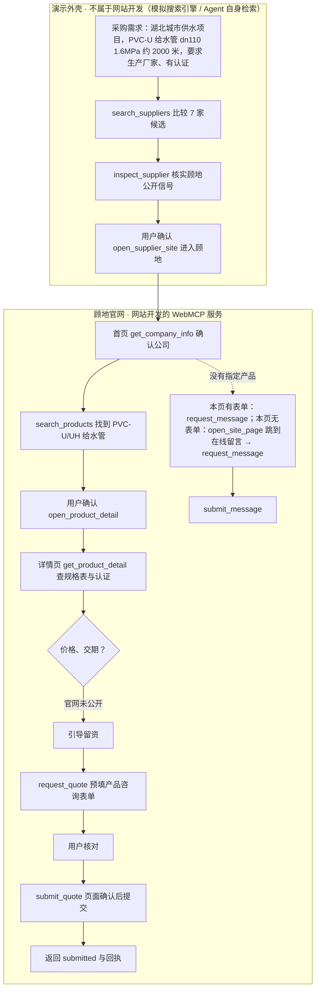
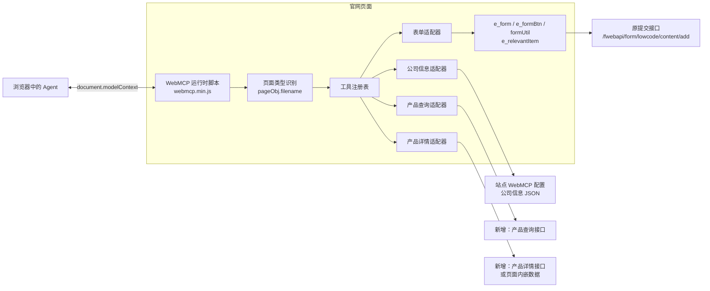

# WebMCP 一期固定演示：流程、服务与实现

- 版本：v0.8
- 日期：2026-11-11
- 演示站：
  - **演示站一：顾地科技** <https://endemo.xuoumaill.cn/>（主线演示，本仓库有可运行模拟）
  - **演示站二：北京中企变压器** <https://cndemo.xuoumaill.cn/>（同一建站平台，按同样规则接入，见 [4.4](#cndemo)）
- 本仓库可运行的模拟：`index.html?view=discover`（模拟搜索）→ `index.html?view=home&site=goody`（顾地模拟官网）

> **范围标识**：本文中标 **【网站开发】** 的是一期要在官网上开发的 WebMCP 服务；标 **【演示外壳 · 不开发】** 的是“从多家公司中发现顾地”的模拟，只在本仓库演示用，代表搜索引擎或 Agent 自身的检索，**不属于网站要开发的 WebMCP**；标 **【站点内容】** 的是演示前要由运营修正的站点设置，不需要开发 WebMCP。

## 目录

1. [定位：与通用产品需求的区别](#scope)
2. [演示目标](#goal)
3. [演示流程](#flow)
4. [本期范围总览](#summary)（4.3 [逐个 WebMCP：功能与所在页面](#per-page)）
5. [演示站现状与改造要求](#gap)
6. [WebMCP 服务定义【网站开发】](#tools)
7. [实现方案【网站开发】](#impl)
8. [演示脚本与预期调用](#script)
9. [验收标准](#acceptance)
10. [二期范围](#next)
11. [本仓库实现对照](#files)
12. [附录 A：发现模拟工具【演示外壳 · 不开发】](#appendix-a)

<a id="scope"></a>

## 1. 定位：与通用产品需求的区别

本文是**一期固定演示需求**：以顾地科技（endemo）为主线、北京中企变压器（cndemo）为第二个站点，用固定的页面和数据，向外部演示“Agent 找到企业 → 指定产品 → 咨询 → 留资”的完整流程。它不替代[通用产品需求](./webmcp-inquiry-product-design.md)。

| 比较项 | 通用产品需求（v0.22） | 一期固定演示（本文） |
|---|---|---|
| 目的 | 中台为所有企业站点生成 WebMCP 工具的产品规则 | 用两个演示站把全流程演示出来 |
| 范围 | 后台属性模板、form 表单 WebMCP Tab、多行业多表单 | endemo、cndemo 两个站点，页面、工具、表单固定 |
| 起点 | 智能体已进入官网 | 演示从多家公司中发现顾地开始；**发现环节是演示外壳，不开发** |
| 产品资料 | 属性模板结构化字段，`get_product_spec(fieldKeys)` | 顾地详情页是富文本加规格表，用 `get_product_detail` 返回 |
| 交期 | `check_lead_time` 读取交货期属性 | 顾地未公开交期，不提供该工具；查不到的问题引导留资 |
| 询价表单 | 多商品子表 + `items/rowRef` | 详情页嵌入的“产品咨询”留资表单，5 个字段，产品自动关联 |
| 打开询价 | `open_inquiry_form` 跳转到表单页 | 表单嵌在详情页，不需要该工具 |
| 产品查找 | 只在首页、分类页、列表页提供 | 官网所有页面都提供 |
| 留资 | 只有实际打开的询价表单页提供 | **每个页面都有留资路径**：有表单的页面用本页表单的工具；没有表单的页面不加留资工具，用 `open_site_page` 跳转到在线留言页 |
| 新增 | — | `get_company_info`、`open_site_page`、`request_message` / `submit_message`；工具描述和结果中引导下一步或留资 |

沿用通用规则：工具只在当前页面注册；预填不等于提交；提交前必须在页面由用户确认；结果状态见 6.6；不公开的信息不得补造。

<a id="goal"></a>

## 2. 演示目标

**让观众看到：一个采购需求，可以由 Agent 找到顾地，查清产品规格，并在用户确认后把线索留给顾地。**

| 目标 | 演示中可见的结果 | 归属 |
|---|---|---|
| 能被找到 | 按采购需求搜索，顾地排第一，摘要能看出是 PVC 给水管生产厂家 | 演示外壳 · 不开发；依赖【站点内容】修正 |
| 能被核实 | Agent 确认顾地是上市生产厂家、有认证、在湖北 | 【网站开发】`get_company_info` |
| 能找到指定产品 | 找到 PVC-U/UH 给水管并打开详情 | 【网站开发】`search_products`、`open_product_detail` |
| 能回答规格 | dn110 × 1.6MPa 查表得公称壁厚 **6.6 mm**；有中国环境标志产品认证 | 【网站开发】`get_product_detail` |
| 不编造 | 价格、交期官网未公开，Agent 说明并引导留资 | 【网站开发】`get_product_detail` 的 `notProvided` |
| 能留资 | 预填“产品咨询”表单，用户核对；授权后页面确认，返回提交结果 | 【网站开发】`request_quote`、`submit_quote` |

<a id="flow"></a>

## 3. 演示流程



| 阶段 | 页面 | 工具 | 完成条件 | 归属 |
|---|---|---|---|---|
| 1 发现 | 模拟搜索页 | `search_suppliers` | 返回排序后的候选摘要，Agent 说明推荐理由 | 演示外壳 · 不开发 |
| 2 核实 | 模拟搜索页 | `inspect_supplier` | 读到顾地一致的标题、组织信息和 llms.txt | 演示外壳 · 不开发 |
| 3 进入 | 模拟搜索页 | `open_supplier_site` | 用户确认后进入顾地首页 | 演示外壳 · 不开发 |
| 4 确认公司 | 首页 / 关于顾地 / 联系我们 | `get_company_info` | 回答主营、上市、生产基地、资质 | 网站开发 |
| 5 找产品 | 任意官网页面 | `search_products` → `open_product_detail` | 找到候选并在用户确认后打开 | 网站开发 |
| 6 咨询 | 产品详情 | `get_product_detail` | 按规格表回答；价格、交期说明未公开 | 网站开发 |
| 7 留资 | 产品详情（嵌入表单） | `request_quote` → `submit_quote` | 预填后待核对；页面确认后提交并返回结果 | 网站开发 |
| 7′ 通用留资 | 在线留言页直接留资；其余页面先跳转 | 在线留言页：`request_message` → `submit_message`；其他页面：`open_site_page(message)` → `request_message` → `submit_message` | 没有指定产品的采购、合作、代理、售后需求 | 网站开发 |

<a id="summary"></a>

## 4. 本期范围总览

### 4.1 网站要开发的 WebMCP 服务（9 项）【网站开发】

| 工具 | 注册页面 | 作用 | 行为 |
|---|---|---|---|
| `get_company_info` | 所有官网页面 | 公司简介、品牌、历史、基地、研发、资质、文化、联系方式 | 只读 |
| `search_products` | 所有官网页面 | 按关键词、分类分页查产品 | 只读 |
| `open_product_detail` | 所有官网页面 | 用户确认后打开产品详情 | 站内跳转 |
| `open_site_page` | 所有官网页面 | 打开首页、关于、联系、产品中心、在线留言 | 站内跳转 |
| `get_product_detail` | 产品详情 | 当前产品简介、特点、应用、参数、规格表、认证 | 只读 |
| `request_quote` | 产品详情 | 预填“产品咨询”表单 | 改页面，不提交 |
| `submit_quote` | 产品详情 | 页面确认后走原提交 | **有业务后果** |
| `request_message` | 在线留言 | 预填本页“在线留言”表单 | 改页面，不提交 |
| `submit_message` | 在线留言 | 页面确认后走原提交 | **有业务后果** |

**留资工具只跟随页面上真实存在的表单**，不为页面增加与内容不符的工具：
**一期只接入两张表单**：产品详情的“产品咨询”（`request_quote` / `submit_quote`）和在线留言页的“在线留言”（`request_message` / `submit_message`）。
- 其他页面（首页、关于、联系、产品列表、案例、新闻等）不注册留资工具，由 `open_site_page` 跳转到“在线留言”页后再留资。工具描述和返回结果会提示 Agent 这样做（见 6.4）。
- 演示站首页的“代理商加盟 · 咨询”表单（`e_form-34`）一期**不接入** WebMCP，页面上照常可人工填写。

### 4.2 页面 × WebMCP 总表

| 页面（`pageObj.filename`） | 公共 4 项<br/>get_company_info · search_products · open_product_detail · open_site_page | get_product_detail | 留资工具 | 留资表单 | 合计 |
|---|---|---|---|---|---|
| 首页（`Home`） | ✓ | — | 无 | 不接入本页“代理商加盟”表单 → `open_site_page(message)` 跳转到在线留言 | 4 |
| 关于顾地（`company`） | ✓ | — | 无 | 本页无表单 → `open_site_page(message)` 跳转到在线留言 | 4 |
| 公司简介（`about_us`） | ✓ | — | 无 | 同上 | 4 |
| 联系我们（`contact_us`） | ✓ | — | 无 | 同上 | 4 |
| 产品中心 / 分类（`product_list`） | ✓ | — | 无 | 同上 | 4 |
| 产品详情（`product_detail`） | ✓ | ✓ | request_quote · submit_quote | 本页“产品咨询”表单 `e_form-37`，自动关联当前产品 | 7 |
| 在线留言（`message`） | ✓ | — | request_message · submit_message | 本页“在线留言”表单 `e_form-11` | 6 |
| 其他（工程案例、新闻、投资者等） | ✓ | — | 无 | 本页无表单 → `open_site_page(message)` | 4 |
| 模拟搜索页【演示外壳 · 不开发】 | — | — | — | — | 3（附录 A） |

本仓库模拟实现了表中除“公司简介”和“其他”以外的页面，工具注册结果与表一致（已在浏览器逐页核对）。

<a id="per-page"></a>

### 4.3 逐个 WebMCP：功能与所在页面

每个工具先说明功能（能做什么、用户怎么问、怎么调用），再列出它应该出现在哪些页面：先写 endemo（顾地），再写 cndemo（北京中企变压器，详见 4.4）。调用示例中的分类 ID、产品 ID 按真实站写（如 `"3"`、`"51"`）；本仓库模拟中对应为 `water`、`pvcu-uh-water`。完整定义见第 6 节，页面与工具的对照见 4.2。

**页面网址一览**（下文“所在页面”按此称呼）

| 页面 | 网址 | 有无表单 |
|---|---|---|
| 首页 | <https://endemo.xuoumaill.cn/> | 有“代理商加盟”表单 `e_form-34`，一期不接入 |
| 关于顾地 | <https://endemo.xuoumaill.cn/company.html> | 无 |
| 公司简介 | <https://endemo.xuoumaill.cn/about_us_1/1.html> | 无 |
| 联系我们 | <https://endemo.xuoumaill.cn/contact_us.html> | 无 |
| 产品中心 / 分类 | <https://endemo.xuoumaill.cn/products_list_1/2.html>，分类如 <https://endemo.xuoumaill.cn/products_list_1/3.html> | 无 |
| 产品详情 | <https://endemo.xuoumaill.cn/product_detail/51.html>（及所有 `/product_detail/{id}.html`） | 有：“产品咨询”`e_form-37` |
| 在线留言 | <https://endemo.xuoumaill.cn/message.html>（`/Message.html` 同页） | 有：“在线留言”`e_form-11` |
| 其他 | 工程案例 <https://endemo.xuoumaill.cn/case.html>、新闻 <https://endemo.xuoumaill.cn/News_list_1/1.html>、新闻详情 <https://endemo.xuoumaill.cn/news_detail/232.html>、售后服务 <https://endemo.xuoumaill.cn/aftercare.html>、投资者关系等 | 无 |

#### 4.3.1 get_company_info：查询公司信息

**功能**：返回官网公开的公司简介、品牌、历史、生产基地与营销网络、研发实力、资质荣誉、品牌文化、联系方式，可按主题只取一部分。用于 Agent 在咨询前确认公司身份与实力。返回结果会引导下一步：查找产品，或按本页的留资方式留资（见 6.4）。只读。

| 用户这样问 | 调用示例 |
|---|---|
| 这家公司是做什么的？是生产厂家吗？有哪些资质认证和生产基地？ | `{"topics":["profile","organization","honors"]}` |
| 顾地是哪一年上市的？股票代码是多少？ | `{"topics":["profile","history"]}` |
| 售后服务热线和公司地址是什么？ | `{"topics":["contact"]}` |

**所在页面**：全部官网页面——首页、关于顾地、公司简介、联系我们、产品中心 / 分类、产品详情、在线留言、其他。在关于顾地、公司简介、联系我们三页，它是页面的主要工具。

cndemo：全部页面；内容取自 `/1-about.html`、`/qualifications.html`、`/1-technology.html`、`/1-service.html`、`/1-contact.html`。

#### 4.3.2 search_products：查找产品

**功能**：按关键词（名称、材质、用途）、产品分类、页码查找已发布产品，每页 6 条，返回名称、分类、概要、详情链接。规格参数（dn、压力）不参与检索。有结果时引导 Agent 先介绍候选、用户确认后再打开；无结果时引导换关键词，或询问用户是否留下需求。只读。

| 用户这样问 | 调用示例 |
|---|---|
| 你们有适合城市供水的 PVC 给水管吗？ | `{"keyword":"PVC 给水管"}` |
| 给水管系列里有哪些产品？ | `{"categoryId":"3"}` |
| 你们做燃气管吗？ | `{"keyword":"燃气"}` |
| 浏览全部产品，看下一页。 | `{"page":2}` |

**所在页面**：全部官网页面。在产品分类页（如 `/products_list_1/3.html`）未指定分类时，默认限定当前分类；在产品中心页调用时，页面列表同步显示结果。

cndemo：全部页面；产品列表页为 `/2-products.html`、`/Product.html`。

#### 4.3.3 open_product_detail：打开产品详情

**功能**：用户确认要看某款产品后，跳转到该产品的详情页。只接受 `search_products` 返回的产品 ID，执行前校验产品已发布、可访问；先返回 `opening` 再跳转。

| 用户这样问 | 调用示例 |
|---|---|
| 好，打开 PVC-U/UH给水管 的详情。 | `{"productId":"51"}` |
| 打开刚才那款 PE 燃气管看看。 | `{"productId":"<search_products 返回的 ID>"}` |

**所在页面**：全部官网页面。

cndemo：全部页面。

#### 4.3.4 open_site_page：打开固定页面

**功能**：打开首页、关于顾地、联系我们、产品中心、在线留言这 5 个固定页面，不接受任意网址。在**没有接入留资表单的页面**，它同时承担“去留资”的作用：描述中写明“用户要留下联系方式时，征得同意后打开 message”，打开在线留言页时返回“进入后用 `request_message` 填写”。

| 用户这样问 | 调用示例 |
|---|---|
| 我想咨询工程合作，帮我留个联系方式。（在没有表单的页面） | `{"page":"message"}` |
| 打开联系我们页面。 | `{"page":"contact"}` |
| 回到产品中心。 | `{"page":"products"}` |

**所在页面**：全部官网页面。其中首页、关于顾地、公司简介、联系我们、产品中心 / 分类、其他页面会带上“跳转留资”的引导；产品详情、在线留言有自己的留资表单，不带此引导。

cndemo：全部页面；固定页面为 home=`/`、company=`/1-about.html`、products=`/2-products.html`、contact 与 message 都是 `/1-contact.html`。除产品详情和 `/1-contact.html` 外都带“跳转留资”的引导。

#### 4.3.5 get_product_detail：读取当前产品资料

**功能**：读取当前详情页产品的概要、简介、特点、应用领域、参数、规格表和认证；规格表按行（公称外径）列（公称压力）返回，Agent 查表回答，不推算。价格、交期、库存不公开，放在 `notProvided` 中，并引导用户用 `request_quote` 留资。只读。

| 用户这样问 | 调用示例 | 预期 |
|---|---|---|
| dn110、1.6MPa 的壁厚是多少？有什么认证？ | `{"sections":["specTables","certifications"]}` | 6.6 mm；中国环境标志产品认证 |
| 这款产品有什么特点，适合哪些场景？ | `{"sections":["features","applications"]}` | 原文特点与应用领域 |
| 这个规格的价格和交期是多少？ | `{}` | 说明未公开，引导留资 |

**所在页面**：只在产品详情页（`/product_detail/{id}.html`）。

cndemo：只在产品详情页 `/Product_detail/{id}.html`、`/1-product_detail/{id}.html`。

#### 4.3.6 request_quote：预填产品咨询表单

**功能**：把用户的联系方式和需求填进详情页“产品咨询”表单，咨询产品由“相关项”自动关联为当前产品；只填写、不提交，填完把表单滚动到可见位置，返回 `awaiting_user_confirmation`。电话、邮箱、详细说明必填，缺失时 Agent 先询问，不编造。

| 用户这样问 | 调用示例 |
|---|---|
| 帮我留资咨询：dn110、1.6MPa 约 2000 米，项目在湖北武汉，希望 12 月中旬供货，请确认价格、交期并提供检测报告。联系人王宁，电话 13800138000，邮箱 wang.ning@example.com。 | `{"contactName":"王宁","phone":"13800138000","email":"wang.ning@example.com","region":"湖北武汉","inquiryContent":"dn110、1.6MPa 约 2000 米，项目在湖北武汉，希望 12 月中旬供货。请确认价格、交期并提供检测报告。"}` |

**所在页面**：只在产品详情页。

cndemo：只在产品详情页，绑定 “Get in touch” 表单 `e_form-39`（First Name、Last Name、Email、Message）。该表单不自动关联产品，工具把当前产品名称写在 Message 开头。参数见 4.4.2。

#### 4.3.7 submit_quote：提交产品咨询

**功能**：用户核对表单并明确要求提交后，先在页面弹出确认，用户确认后触发原“立即提交”按钮，等待原系统结果并返回 `submitted`（附回执）、`cancelled`、`validation_error`、`failed` 或 `unknown`。不得在预填后自动调用；成功后不承诺回复时间。

| 用户这样问 | 调用示例 |
|---|---|
| 我已核对表单，信息无误，请提交并告诉我结果。 | `{}` |

**所在页面**：只在产品详情页。

cndemo：只在产品详情页（`e_form-39`）。

#### 4.3.8 request_message：预填留资表单

**功能**：用户有采购需求、合作、代理经销、工程项目或售后等事项（不针对某款产品）要留下联系方式时，填写在线留言页的“在线留言”表单；只填写、不提交。电话、邮箱、留言内容必填，缺失时先询问。

| 所在页面 | 表单 | 参数（\* 必填） | 用户这样问 | 调用示例 |
|---|---|---|---|---|
| 在线留言 | “在线留言”`e_form-11` | contactName、phone\*、email\*、message\* | 帮我留言：想了解工程项目合作和经销政策。联系人王宁，电话 13800138000，邮箱 wang.ning@example.com。 | `{"contactName":"王宁","phone":"13800138000","email":"wang.ning@example.com","message":"想了解工程项目合作和经销政策"}` |

**所在页面**：只在在线留言页。其他页面不注册，由 `open_site_page` 跳到在线留言页后使用。

cndemo：只在联系我们 `/1-contact.html`，绑定「立即咨询 · 获取工艺方案」表单 `e_form-18`；参数与 endemo 不同（多了公司名称、反馈类型，且有条款协议），见 4.4.3。

#### 4.3.9 submit_message：提交留资表单

**功能**：用户核对本页留资表单并明确要求提交后，页面确认、触发原提交按钮、返回实际结果，规则同 `submit_quote`。

| 用户这样问 | 调用示例 |
|---|---|
| 确认无误，请提交。 | `{}` |

**所在页面**：只在在线留言页。

cndemo：只在 `/1-contact.html`。提交前条款协议必须由用户本人勾选，未勾选返回 `validation_error`。

<a id="cndemo"></a>

### 4.4 演示站二：cndemo.xuoumaill.cn（北京中企变压器）

cndemo 与 endemo 在同一建站平台，WebMCP 运行时、9 项工具和接入规则相同，只是页面、表单和站点配置不同。本仓库的可运行模拟只覆盖顾地（endemo）。以下页面类型（`pageObj.filename`）和表单均于 2026-11-11 从线上页面读取。

#### 4.4.1 页面与 WebMCP

公共 4 项 = `get_company_info`、`search_products`、`open_product_detail`、`open_site_page`。

| 页面 | 网址 | `pageObj.filename` | 页面上的表单 | WebMCP | 数量 |
|---|---|---|---|---|---|
| 首页（英文模板） | <https://cndemo.xuoumaill.cn/> | `Home` | “Get in touch” `e_form-1`（不接入） | 公共 4 项 | 4 |
| 中文首页 | <https://cndemo.xuoumaill.cn/1-homepage.html> | `1-homepage` | 无 | 公共 4 项 | 4 |
| 关于我们 | <https://cndemo.xuoumaill.cn/1-about.html> | `1-about` | 无 | 公共 4 项 | 4 |
| 荣誉资质 | <https://cndemo.xuoumaill.cn/qualifications.html> | `qualifications` | 无 | 公共 4 项 | 4 |
| 产品中心 | <https://cndemo.xuoumaill.cn/2-products.html>、<https://cndemo.xuoumaill.cn/Product.html> | `2-products`、`Product` | `Product` 页有 `e_form-1`（不接入） | 公共 4 项 | 4 |
| **产品详情** | <https://cndemo.xuoumaill.cn/Product_detail/16.html>、<https://cndemo.xuoumaill.cn/1-product_detail/9.html> | `Product_detail` | **“Get in touch” `e_form-39`（接入）**；页脚 `e_form-1`（不接入） | 公共 4 项 + `get_product_detail` + `request_quote` · `submit_quote` | 7 |
| 智能选配报价 | <https://cndemo.xuoumaill.cn/1-configurator.html> | `1-configurator` | 选型器 `e_form-30`（零件类型、加工材料、精度、年产量；不接入，二期可做设备推荐工具） | 公共 4 项 | 4 |
| 技术创新 / 服务支持 | <https://cndemo.xuoumaill.cn/1-technology.html>、<https://cndemo.xuoumaill.cn/1-service.html> | `1-technology`、`1-service` | 无 | 公共 4 项 | 4 |
| 案例中心 | <https://cndemo.xuoumaill.cn/cases.html> | `cases` | 无 | 公共 4 项 | 4 |
| 新闻中心 | <https://cndemo.xuoumaill.cn/4-news.html> | `4-news` | 订阅表单 `e_form-5`（只填邮箱；不接入） | 公共 4 项 | 4 |
| **联系我们（中文）** | <https://cndemo.xuoumaill.cn/1-contact.html> | `1-contact` | **「立即咨询 · 获取工艺方案」`e_form-18`（接入）** | 公共 4 项 + `request_message` · `submit_message` | 6 |
| 英文页面 | Services、About、FAQ、Blog、Contact（如 <https://cndemo.xuoumaill.cn/Contact.html>） | 同名 | 多数有 `e_form-1`（不接入） | 公共 4 项 | 4 |

与 endemo 一致：只接入**产品详情**和**留言（联系我们）**两张表单；其他页面上的表单（全站 “Get in touch”、选型器、订阅）一期都不接入，用户要留资时由 `open_site_page` 跳到 `/1-contact.html`。

`open_site_page` 在 cndemo 的固定页面：

| page | 网址 |
|---|---|
| home | `/` |
| company | `/1-about.html` |
| products | `/2-products.html` |
| contact | `/1-contact.html` |
| message | `/1-contact.html`（与 contact 同页） |

#### 4.4.2 request_quote（cndemo 产品详情 `e_form-39`）

```json
{"type":"object","properties":{
  "firstName":{"type":"string","description":"名：First Name"},
  "lastName":{"type":"string","description":"姓：Last Name"},
  "email":{"type":"string","format":"email","description":"联系邮箱：Email"},
  "message":{"type":"string","description":"咨询内容：规格、数量、用途、期望交期，以及需要确认的价格、交期等问题"}
},"required":[],"additionalProperties":false}
```

| 参数 | 组件 | 页面占位 |
|---|---|---|
| firstName | `e_clueName-47` | First Name |
| lastName | `e_clueName-46` | Last Name |
| email | `e_clueEmail-48` | Email |
| message | `e_textarea-49` | Message... |

- 该表单在页面上**没有标必填**，`required` 按已发布定义为空。建议运营把 Email、Message 设为必填，届时 `required` 自动变为 `["email","message"]`。
- 表单**不关联产品**（没有“相关项”组件），`request_quote` 在 `message` 开头自动写入“咨询产品：{当前产品名称}”，以便销售识别。

#### 4.4.3 request_message（cndemo 联系我们 `e_form-18`）

```json
{"type":"object","properties":{
  "contactName":{"type":"string","description":"您的姓名"},
  "company":{"type":"string","description":"公司名称"},
  "phone":{"type":"string","description":"联系电话"},
  "email":{"type":"string","format":"email","description":"电子邮箱"},
  "feedbackType":{"type":"string","enum":["来件试切申请","工艺方案咨询","产品选型","预约看机","技术支持"],"description":"反馈类型"},
  "message":{"type":"string","description":"详细反馈：加工需求、零件与材料、数量、期望时间等"}
},"required":["contactName","phone","email","feedbackType","message"],"additionalProperties":false}
```

| 参数 | 组件 | 必填 |
|---|---|---|
| contactName | `e_input-30` 您的姓名 | 是 |
| company | `e_input-29` 公司名称 | 否 |
| phone | `e_input-33` 联系电话 | 是 |
| email | `e_input-32` 电子邮箱 | 是 |
| feedbackType | `e_cardLabel-22` 反馈类型 | 是（单选或多选以表单定义为准，需确认） |
| message | `e_textarea-24` 详细反馈 | 是 |
| —（不作为参数） | `e_agreement-25` 条款协议 | 是 |

- **条款协议**不作为工具参数，Agent 不能代用户勾选。`request_message` 填完后返回 `awaiting_user_confirmation`，并提示“请用户阅读并勾选条款协议”；`submit_message` 发现未勾选时返回 `validation_error`。
- 提交成功跳转 `/successfully1.html`，处理方式同 7.6。

#### 4.4.4 cndemo 站点内容问题【站点内容】

| 信号 | 现状（2026-11-11） | 建议 |
|---|---|---|
| JSON-LD Organization | name 为“中企一家专业的建站公司”，alternateName“中企动力” | 改为北京中企变压器有限公司 |
| meta keywords | cellulose film, outdoor patio furniture 等无关词 | 改为断路器、变压器、CNC 加工等主营词 |
| meta / og description | 断路器与“光学影像测量仪、二次元”混写，内容重复 | 按主营重写一段 |
| 产品 | “家用挤水拖把桶”“Product Demo 1”等测试产品；llms.txt 分类名为“Eyes（Get backend category name）” | 下线测试产品，修正分类名 |
| 联系方式 | 邮箱 `account@mail.com` 为占位 | 改为真实邮箱 |
| 页面结构 | 英文页（Product、Contact…）与中文页（2-products、1-contact…）两套并存，`/1-OEM.html` 返回空页面 | 演示前确认主导航用哪套；修复空页面 |
| 访问 | 内置浏览器打开根地址时被跳转到 endemo（疑似按语言跳转），直接请求返回正常 | 需确认跳转规则，避免演示时跳错站 |

### 4.5 不开发的部分

| 内容 | 性质 | 说明 |
|---|---|---|
| 模拟搜索页与 `search_suppliers`、`inspect_supplier`、`open_supplier_site` | 【演示外壳 · 不开发】 | 代表搜索引擎或 Agent 自身检索。真实场景中，Agent 靠站点的标题、描述、结构化数据、llms.txt 被发现，网站不提供“发现”类 WebMCP。定义见附录 A |
| 7 家候选公司（除顾地外均虚构） | 【演示外壳 · 不开发】 | 只在本仓库 `demo/discovery.js` 中 |
| 发现层信号修正 | 【站点内容】 | 运营在站点设置、SEO、结构化数据、llms.txt 中修正，见 5.1。不改的话，演示的发现环节站不住 |
| 测试产品、无关新闻清理 | 【站点内容】 | 见 5.1 |

<a id="gap"></a>

## 5. 演示站现状与改造要求

### 5.1 发现层与站点内容修正【站点内容】

2026-11-10 对演示站的检查结果。

| 信号 | 现状 | 修正后（模拟官网已采用） |
|---|---|---|
| `<title>` | Magnetic building blocks | 顾地科技｜PVC-U 给水管、排水管等塑料管道系统生产厂家 |
| meta description | `http://www.wintom.cn/ 零售TOC，对个人有翅膀可以飞的` | 顾地科技（股票代码 002694）始创于 1979 年，总部位于湖北鄂州……PVC-U/UH 给水管通过中国环境标志产品认证 |
| meta keywords | newborn diapers, baby diapers, best diapers, 相机镜头供应商 | PVC给水管, PVC-U给水管, 塑料管道, 市政给排水, 顾地科技 |
| og:title / og:site_name | 优质相机镜头供应商 / `http://www.wintom.cn/` | 顾地科技｜塑料管道系统生产厂家 / 顾地科技 |
| html lang | en | zh-CN |
| JSON-LD Organization | 两个：`http://www.wintom.cn/` 与顾地科技（url 指向 goody.com.cn） | 一个：顾地科技，url 为本站，带地址和简介；保留 FAQ |
| 产品页 JSON-LD | brand 为 `http://www.wintom.cn/` | brand 为顾地 |
| llms.txt | 标题 Magnetic building blocks；简介被截断；“关于顾地”写成面向个人的零售业务 | 标题顾地科技；完整简介含生产基地与给水管认证 |
| 产品中心 | 混有圆珠笔、摩托车、Product 01/02、“123”、断路器等测试产品 | 下线测试产品 |
| 首页新闻 | 纸尿裤文章 | 换成管材资讯或隐藏 |
| 首页统计文案 | “……成功上市看乐乐看。 比哦”，上市年份写 2017 | 改为 2012 年上市，去掉测试文字 |

### 5.2 页面结构与通用需求的差异

| 通用需求假设 | 演示站实际 | 一期处理 |
|---|---|---|
| 规格来自属性模板结构化字段 | 详情页规格在富文本（`e_richText`）和表格中 | `get_product_detail` 返回简介、特点、应用、参数和规格表，表格按行列返回 |
| 有交货期属性 | 没有 | 不提供 `check_lead_time`；在 `notProvided` 中声明价格、交期、库存未公开 |
| 询价表单有商品子表 | “产品咨询”表单 `e_form-37`：名字、电话\*、邮箱\*、地区、详细说明\*，`e_relevantItem-39` 按页面参数 productId 自动关联产品 | `request_quote` 只含联系与说明字段，产品作为上下文 |
| 询价表单在独立页面 | 嵌在详情页；提交成功后跳到 `/Message.html` | 不需要 `open_inquiry_form`；提交工具必须在跳转前拿到结果（见 7.6） |
| 有站内搜索 | 没有搜索框，列表服务端分页 | 新增产品查询接口（见 7.5.2） |
| 留资表单只在询价页 | 只有 3 个页面有表单：首页 `e_form-34`（代理商加盟 · 咨询）、产品详情 `e_form-37`（产品咨询）、在线留言 `e_form-11`；其他页面没有表单 | 一期只接入产品咨询、在线留言两张表单；首页表单不接入；其他页面不加留资工具，引导跳转到在线留言页 |

<a id="tools"></a>

## 6. WebMCP 服务定义【网站开发】

以下 description 与 inputSchema 和本仓库模拟实现一致，生产实现直接沿用。所有工具用命令式 `document.modelContext.registerTool` 注册，`execute` 返回 JSON 字符串。

### 6.1 公共工具（所有官网页面）

#### get_company_info

查询顾地科技官网公开的公司信息：简介、品牌、历史、生产基地与营销网络、研发实力、资质荣誉、品牌文化、联系方式。用于在咨询前确认公司身份与实力。回答后可引导用户下一步：查找产品（`search_products`），或有采购、合作意向时{留资方式}。

> `{留资方式}` 按页面替换，见 6.4 第一张表。下同。

```json
{"type":"object","properties":{"topics":{"type":"array","description":"要查询的主题，不传时返回全部：profile=公司简介；brands=品牌；history=品牌历史；organization=生产基地与营销网络；strength=研发实力；honors=资质荣誉；culture=品牌文化；contact=联系方式。","items":{"type":"string","enum":["profile","brands","history","organization","strength","honors","culture","contact"]},"minItems":1,"uniqueItems":true}},"additionalProperties":false}
```

返回：`status`、`company`、`topics`（每个主题含 `title`，以及 `text`、`items` 或 `contact` 之一）、`message`（下一步引导）。非法主题返回 `validation_error`。

#### search_products

查找顾地科技官网公开的产品，可按关键词（名称、材质、用途）和产品分类筛选，分页返回产品名称、分类、概要和详情链接。规格参数（如 dn、压力）不参与检索，请先找到产品再查看详情。找到候选后先向用户介绍，用户确认后再调用 `open_product_detail`；找不到合适产品时，可询问用户是否留下需求，由企业跟进：{留资方式}。

```json
{"type":"object","properties":{"keyword":{"type":"string","description":"关键词，如“PVC 给水管”“燃气”；不填时浏览。"},"categoryId":{"type":"string","enum":["water","drainage","power","irrigation","aquaculture","gas","heating","home","other"],"description":"产品分类：water=环保给水管系列；drainage=排水排污管系列；power=电力通讯管系列；irrigation=农用灌溉管系列；aquaculture=渔业养殖管系列；gas=燃气输送管系列；heating=采暖管系列；home=顾地家装管系列；other=其它管网系列。"},"page":{"type":"integer","minimum":1,"default":1,"description":"页码，默认第 1 页。"}},"additionalProperties":false}
```

返回：`status`、`keyword`、`category`、`page`、`hasMore`、`total`、`products[]`（`productId`、`name`、`category`、`summary`、`detailUrl`）、`message`。每页 6 条。生产环境 `categoryId` 的取值用站点真实分类 ID（3、4、6……），描述中列出名称。

#### open_product_detail

用户确认要查看某款产品后，打开顾地官网该产品的详情页。仅站内跳转，不查询或修改资料。

```json
{"type":"object","properties":{"productId":{"type":"string","description":"使用 search_products 返回的 productId。"}},"required":["productId"],"additionalProperties":false}
```

返回 `opening`。模拟实现把 11 款产品 ID 写进 `enum`；生产环境产品多时省略 `enum`，执行前校验（见 7.5.3）。

#### open_site_page

用户要求时打开顾地官网的固定页面：home=官网首页，company=关于顾地，contact=联系我们，products=产品中心，message=在线留言（采购需求、合作、经销、售后留言）。在没有接入留资表单的页面，描述末尾追加：本页没有留资表单，用户要留下联系方式时，征得同意后打开 message，再在该页用 `request_message` 填写。

```json
{"type":"object","properties":{"page":{"type":"string","enum":["home","company","contact","products","message"],"description":"home=官网首页；company=关于顾地；contact=联系我们；products=产品中心；message=在线留言"}},"required":["page"],"additionalProperties":false}
```

返回 `opening`。只接受固定页面，不接受任意 URL。

### 6.2 产品详情页工具

#### get_product_detail

读取当前页面产品的公开资料：概要、简介、特点、应用领域、参数、规格表和认证。规格表按行（公称外径）与列（公称压力）原样返回，请据此查表回答，不要推算表中没有的组合。价格、交货期、库存不在官网公开；用户问到这些或表示要询价时，引导用户用 `request_quote` 在本页留资。

```json
{"type":"object","properties":{"sections":{"type":"array","description":"只返回指定部分，不传时返回全部：overview=简介，features=特点，applications=应用领域，params=参数，specTables=规格表，certifications=认证。","items":{"type":"string","enum":["overview","features","applications","params","specTables","certifications"]},"minItems":1,"uniqueItems":true}},"additionalProperties":false}
```

返回示例（节选）：

```json
{
  "status": "ok",
  "product": {"id": "51", "name": "PVC-U/UH给水管", "category": "环保给水管系列", "summary": "…"},
  "specTables": [{
    "title": "PVC-U/UH给水管规格",
    "rowHeader": "公称外径 dn（mm）", "columnHeader": "公称压力（MPa）", "cellMeaning": "公称壁厚（mm）",
    "columns": ["0.63","0.8","1.0","1.25","1.6","2.0","2.5"],
    "rows": [{"dn": "110", "values": ["2.7","3.4","4.2","5.3","6.6","8.1","10.0"]}],
    "note": "“/”表示该外径与压力组合不提供。"
  }],
  "certifications": ["中国环境标志产品认证"],
  "notProvided": ["价格", "交货期", "库存"],
  "message": "仅返回本页公开资料。价格、交货期、库存未在官网公开。用户问到这些或有采购意向时，请引导用户留资：调用 request_quote 预填本页“产品咨询”表单，由销售确认。"
}
```

#### request_quote

用户明确要咨询或询价时，填写本页“产品咨询”表单（咨询产品已自动关联为当前产品），供用户在页面核对；本工具不提交。规格、数量、项目地点、价格交期等待确认问题写入 `inquiryContent`。电话、邮箱等必填信息用户没给时先询问，不要编造。

```json
{"type":"object","properties":{
  "contactName":{"type":"string","description":"你的名字：你的名字"},
  "phone":{"type":"string","description":"联系人电话号码（手机或座机）"},
  "email":{"type":"string","format":"email","description":"电子邮件：您的电子邮件地址"},
  "region":{"type":"string","description":"项目或采购方所在地区，如“湖北武汉”"},
  "inquiryContent":{"type":"string","description":"咨询详情：规格、数量、项目地点、期望供货时间，以及需要销售确认的价格、交期、检测报告等问题"}
},"required":["phone","email","inquiryContent"],"additionalProperties":false}
```

| 参数 | 页面字段 | 演示站组件 | 控件 `name` | 必填 |
|---|---|---|---|---|
| contactName | 你的名字 | `e_clueName-50` | `name1710405159852` | 否 |
| phone | 您的电话号码 | `e_clueMobile-48` | `mobile1710405122396` | 是 |
| email | 您的电子邮件地址 | `e_clueEmail-49` | `email1710405140587` | 是 |
| region | 您所在的地区 | `e_input-41` | `e_input-41` | 否 |
| inquiryContent | 详细说明 | `e_textarea-44` | `e_textarea-44` | 是 |

产品由“相关项”`e_relevantItem-39` 关联，不作为参数。返回 `awaiting_user_confirmation`，或带 `fieldErrors` 的 `validation_error`；同时把表单滚动到可见位置。

#### submit_quote

用户核对本页“产品咨询”表单并明确要求提交后调用。使用页面当前值，先在页面请求用户确认，再走原提交处理并返回实际结果；不得在预填后自动调用。

```json
{"type":"object","properties":{},"additionalProperties":false}
```

返回 `submitted`（含 `receipt`）、`cancelled`、`validation_error`、`failed` 或 `unknown`。

### 6.3 通用留资工具（在线留言页）

#### request_message

用户有采购需求、合作、代理经销、工程项目或售后等事项要留下联系方式时，填写本页“在线留言”表单，供用户核对；本工具不提交。要就某款产品询价时，先打开该产品详情页使用 `request_quote`。电话、邮箱等必填信息用户没给时先询问，不要编造。

在线留言表单：

```json
{"type":"object","properties":{
  "contactName":{"type":"string","description":"你的名字：你的名字"},
  "phone":{"type":"string","description":"联系人电话号码（手机或座机）"},
  "email":{"type":"string","format":"email","description":"电子邮件：电子邮件地址"},
  "message":{"type":"string","description":"留言内容：采购需求、合作、经销、工程项目或售后等需要企业回复的事项"}
},"required":["phone","email","message"],"additionalProperties":false}
```

| 表单 | 演示站控件 `name` |
|---|---|
| 在线留言 `e_form-11` | `text1711552842573`（名字）、`text1711552859516`（电话）、`text1727623015026`（邮箱）、`textarea1711552919507`（备注） |

不关联产品。

#### submit_message

用户核对本页“在线留言”表单并明确要求提交后调用。先在页面请求用户确认，再走原提交处理并返回实际结果；不得在预填后自动调用。输入为 `{}`，返回规则同 `submit_quote`。

### 6.4 描述与结果中的下一步引导

工具不仅回答当前问题，还在 `description` 和返回的 `message` 中提示 Agent 下一步，把对话自然引向留资。所有引导都要求先征得用户同意，不自动填写或提交。

“留资方式”随页面变化：

| 页面 | 引导文字中的留资方式 |
|---|---|
| 在线留言 | 用本页 `request_message` 留下联系方式 |
| 产品详情 | 用本页 `request_quote` 留下联系方式 |
| 其余页面（含首页） | 用 `open_site_page`（page=message）跳转到“在线留言”页，再在该页用 `request_message` 留资 |

| 工具 | 引导内容 |
|---|---|
| `get_company_info` | 回答后询问用户是否要查找产品（`search_products`）；有采购、合作、代理意向时按上表的留资方式 |
| `search_products` | 有结果：介绍候选，用户确认后 `open_product_detail`；无结果：建议换关键词或分类，也可询问用户是否留下需求，按上表的留资方式 |
| `open_site_page` | 在没有表单的页面，描述中写明“用户要留下联系方式时，征得同意后打开 message”；打开 message 时返回“进入后用 `request_message` 填写用户已提供的信息，缺电话或邮箱先询问” |
| `get_product_detail` | 价格、交期、库存未公开；用户问到这些或有采购意向时，用 `request_quote` 在本页留资 |
| `request_quote` / `request_message` | 必填信息缺失先询问，不编造；预填后请用户核对，可自行提交或授权 Agent 提交 |
| `submit_quote` / `submit_message` | 成功后告诉用户已提交并附回执编号，**不承诺回复时间**；可询问是否还要了解其他产品或公司信息 |

### 6.5 annotations

| 工具 | readOnlyHint | consequentialHint | untrustedContentHint |
|---|---|---|---|
| get_company_info、search_products、get_product_detail | true | false | true |
| open_product_detail、open_site_page | false | false | true |
| request_quote、request_message | false | false | true |
| submit_quote、submit_message | false | **true** | true |

### 6.6 结果状态

| status | 含义 | Agent 的表达 |
|---|---|---|
| ok | 查询成功（含空结果） | 按实际结果回答；空结果说“按当前条件未找到” |
| opening | 已受理跳转 | 以目标页面实际打开为准，进入后重新读取工具 |
| not_available | 无法提供 | 说明无法提供，不编造 |
| validation_error | 参数或表单校验未通过 | 指出字段，保留已填内容 |
| awaiting_user_confirmation | 表单已预填 | 请用户核对；不说“已提交” |
| cancelled | 用户在页面取消提交 | 未提交，表单保留 |
| submitted | 原提交明确成功 | 告知已提交，有编号附编号 |
| failed | 原提交明确失败（如提交频率限制） | 说明失败原因，不自动重试 |
| unknown | 结果无法确认（如超时） | 先核对，不自动重提 |

<a id="impl"></a>

## 7. 实现方案【网站开发】

本节说明如何在演示站所在的建站平台上实现第 6 节的 9 项服务。凡标“需确认”的，是从演示站前端脚本推断、需要平台研发核实的点。

### 7.1 总体架构



原则：

- **只在前端加一层**：新增一个平台公共脚本，不改各页面模板；表单提交复用原组件和原接口。
- **工具按页面类型注册**：页面类型取自页面全局变量 `pageObj.filename`。
- **数据只读公开内容**：查询类接口只返回已发布、前台可见的数据。

### 7.2 加载与启用

| 项 | 实现 |
|---|---|
| 站点开关 | 站点设置新增“启用 WebMCP”，开启后平台在页面 `<head>` 输出运行时脚本 `npublic/libs/widget/webmcp.min.js` 和站点配置（见 7.4） |
| 浏览器能力检测 | 脚本先判断 `window.isSecureContext && document.modelContext?.registerTool`，不满足直接退出，不影响页面 |
| Origin Trial | 若不想让访客手动开启测试开关，平台在 `<head>` 输出 `<meta http-equiv="origin-trial" content="TOKEN">`，TOKEN 按域名申请。演示阶段可只用 Chrome 测试开关 |
| 加载时机 | 等页面组件初始化完成后再注册（表单组件在 `init` 中绑定事件、相关项异步加载数据）。建议监听平台的组件就绪事件（需确认），没有的话在 `window.load` 后注册 |

### 7.3 页面类型与工具映射

| `pageObj.filename` | 演示站页面 | 注册的工具 |
|---|---|---|
| `Home` | `/` | 公共 4 项（本页“代理商加盟”表单一期不接入，留资经 `open_site_page` 跳转） |
| `company` | `/company.html` | 公共 4 项（无表单，留资经 `open_site_page` 跳转） |
| `about_us` | `/about_us_1/1.html` | 同上 |
| `contact_us` | `/contact_us.html` | 同上 |
| `product_list` | `/products_list_1/{分类}.html` | 同上；`search_products` 默认限定当前分类 |
| `product_detail` | `/product_detail/{id}.html` | 公共 4 项 + `get_product_detail`、`request_quote`、`submit_quote`（本页 `e_form-37`） |
| `message` | `/message.html`（`/Message.html` 同页） | 公共 4 项 + `request_message`、`submit_message`（本页 `e_form-11`） |
| 其他 | 新闻、案例、投资者等 | 公共 4 项（无表单，留资经 `open_site_page` 跳转） |

cndemo 的页面类型与工具见 4.4.1，同一运行时按站点配置区分两个站。

留资工具**只按页面上实际存在、已开启 WebMCP 的表单**注册，每页最多一组；页面上没有表单就不注册留资工具，运行时把 `open_site_page` 的描述和公共工具的引导文字切换为“跳转到在线留言页留资”（见 6.4）。表单与工具名的对应关系由站点配置指定（见 7.4）。

### 7.4 站点 WebMCP 配置

一期是固定演示，配置以一份站点级 JSON 维护（平台后台录入或研发配置），随页面输出：

```html
<script type="application/json" id="webmcp-config">
{
  "company": { "profile": {"title":"公司简介","text":"…"}, "contact": {"title":"联系方式","contact":{…}}, … },
  "pages":   { "home":"/", "company":"/company.html", "contact":"/contact_us.html",
               "products":"/products_list_1/2.html", "message":"/message.html" },
  "categories": [ {"id":"3","name":"环保给水管系列"}, … ],
  "forms": {
    "e_form-37": { "page":"product_detail", "title":"产品咨询", "fill":"request_quote", "submit":"submit_quote",
                   "button":"e_formBtn-45", "buttonEid":"<与 formSuccess 事件中 eid 相同的值>", "relevantItem":"e_relevantItem-39",
                   "fields": { "contactName":"name1710405159852", "phone":"mobile1710405122396",
                               "email":"email1710405140587", "region":"e_input-41", "inquiryContent":"e_textarea-44" },
                   "descriptions": { "phone":"联系人电话号码（手机或座机）", … } },
    "e_form-11": { "page":"message", "title":"在线留言", "fill":"request_message", "submit":"submit_message", … }
  },
  "leadFallbackPage": "message"
}
</script>
```

cndemo 用同样结构的另一份配置（节选）：

```json
{
  "pages": { "home":"/", "company":"/1-about.html", "contact":"/1-contact.html",
             "products":"/2-products.html", "message":"/1-contact.html" },
  "forms": {
    "e_form-39": { "page":"Product_detail", "fill":"request_quote", "submit":"submit_quote", "prefixProductName": true, … },
    "e_form-18": { "page":"1-contact", "fill":"request_message", "submit":"submit_message", "agreement":"e_agreement-25", … }
  },
  "leadFallbackPage": "message"
}
```

- `company` 的内容取自“关于顾地”“联系我们”页面，一期人工整理一次（模拟实现见 `demo/goody-data.js` 的 `companyTopics`）。
- `forms.*.fields` 把工具参数映射到控件 `name`；`descriptions` 即通用需求 7.4 中“WebMCP 字段描述”的一期简化版。
- 二期再改为从后台 form 表单 WebMCP Tab 与公司信息组件自动生成。

### 7.5 各服务实现

#### 7.5.1 get_company_info

读取 `#webmcp-config` 中的 `company`，按 `topics` 过滤后返回。纯前端，无接口调用。

#### 7.5.2 search_products

现有产品列表是服务端渲染（如 `/product_list/{分类}-{偏移}-{条数}.html`），没有可供前端调用的查询接口，需**新增后端接口**：

```text
POST /api/webmcp/products/search      （路径需平台确定，可经 cmsAjax.postJson 调用）
请求：{ "keyword": "PVC 给水管", "categoryId": "3", "from": 0, "size": 6 }
响应：{ "total": 2, "list": [ { "id": "51", "name": "PVC-U/UH给水管", "categoryId": "3",
         "categoryName": "环保给水管系列", "summary": "…", "url": "/product_detail/51.html" } ] }
```

- 数据源与产品列表页相同，只查**已发布、前台可见**的产品。
- `keyword` 匹配名称、概要、分类名、标签；规格参数不参与检索。
- 前端把 `list` 转成 6.1 的返回结构，`detailUrl` 用响应中的 `url` 拼成绝对地址。
- 在 `product_list` 页面且未传 `categoryId` 时，默认带当前分类。

#### 7.5.3 open_product_detail / open_site_page

- `open_product_detail`：运行时缓存本页最近一次 `search_products` 返回的 `productId → url`；不在缓存中的 ID，调用查询接口按 ID 校验（需接口支持按 ID 查询）。校验通过后先返回 `opening`，再 `setTimeout(() => location.assign(url), 80)`，保证结果先送达 Agent。
- `open_site_page`：只从配置 `pages` 中取地址，不接受任意 URL。

#### 7.5.4 get_product_detail

| 数据 | 来源 | 处理 |
|---|---|---|
| 名称、概要、图片、链接 | 页面 JSON-LD `Product`（已存在） | 直接读取；修正 brand 字段（见 5.1） |
| 分类 | 面包屑或产品数据 | 取“所属分类” |
| 简介、特点、应用领域 | 详情富文本组件 `e_richText-*` | 按小标题“产品简介 / 产品特点 / 应用领域”切段，段内按序号拆成列表 |
| 规格表 | 富文本中的 `<table>` | 见下方“规格表解析” |
| 认证 | 一期在产品扩展字段维护（如“WebMCP 认证”），或从简介中人工摘录 | 不做自动推断 |
| 价格、交期、库存 | 官网不公开 | 固定写入 `notProvided` |

**规格表解析**：演示站 51 号产品的表格有两行表头（第 1 行“公称外径 dn,mm | 公称压力 MPa”，第 2 行压力值，另有一行“公称壁厚 mm”说明单元格含义），后面 24 行数据。富文本表格格式不统一，自动解析容易出错，一期建议：

1. **演示产品**：在产品扩展字段中维护结构化规格表 JSON（`rowHeader`、`columnHeader`、`cellMeaning`、`columns`、`rows`、`note`），运行时优先读取。
2. **其余产品**：用通用解析兜底——取首个数字行作为列头，首列作为行头，单元格原样保留（包括“/”）；解析失败时返回 `specTables: []`，并在 `message` 中说明“规格表请查看页面”。

一期可以在页面输出时把以上内容组装成 `<script type="application/json" id="webmcp-product">`，由运行时直接读取，不额外请求接口。

#### 7.5.5 request_quote / request_message：表单适配器

演示站表单由 `e_form`（规则联动）、`e_formBtn`（提交）、`formUtil`（取值、属性）组成，字段是 `e_clueName`、`e_clueMobile`、`e_clueEmail`、`e_input`、`e_textarea` 等组件，控件带 `name` 与 `data-name`。

```js
function fillForm(formId, args) {
  const cfg = config.forms[formId];
  const root = document.querySelector('.' + formId);
  const unknown = Object.keys(args).filter(k => !(k in cfg.fields));
  if (unknown.length) return result('validation_error', {message: '输入包含当前表单不存在的字段'});
  for (const [key, value] of Object.entries(args)) {
    const input = root.querySelector(`[name="${cfg.fields[key]}"]`);
    input.value = String(value);
    // 触发原组件监听：e_form 的联动规则监听 change/input/propertychange
    $(input).trigger('input').trigger('change');
  }
  const errors = validate(root, cfg);          // 见下
  root.scrollIntoView({behavior: 'smooth', block: 'start'});
  return errors ? result('validation_error', {fieldErrors: errors})
                : result('awaiting_user_confirmation', {form: cfg.title});
}
```

- **校验**：复用原组件的校验（需确认 `formUtil` 是否暴露单字段/整表校验方法）；没有的话，按组件的 `required` 属性和线索组件类型（手机、邮箱格式）做同等校验，错误写入组件的 `.invalid-feedback`，与手动填写时的提示一致。
- **相关项**：`e_relevantItem-39` 的数据源按页面参数 `productId` 自动带入当前产品（`.p_tabelList tbody` 由组件异步填充）。填写前检查是否已有关联行，没有则返回 `validation_error`，提示“当前产品未关联，请刷新页面”。产品名称可从行的 `dataobj` 读取，写入返回结果供 Agent 复述。
- **不覆盖未传字段**：只写入 `args` 中出现的字段，用户已手动填写的其他字段保持不变。
- 本工具绝不触发提交。

**没有表单的页面：跳转到在线留言页**

关于、联系、产品列表、案例、新闻等页面原本没有表单，**不为它们增加留资工具或悬浮表单**。运行时检测到本页没有已配置的表单时：

1. 不注册 `request_*` / `submit_*`；
2. `open_site_page` 的描述追加“本页没有留资表单，用户要留下联系方式时，征得同意后打开 message”；
3. `get_company_info`、`search_products` 的引导文字改为“用 `open_site_page`（page=message）跳转到在线留言页，再用 `request_message` 留资”；跳转目标取配置 `leadFallbackPage`。

联系方式不经 URL 传递到下一页（避免个人信息出现在地址中）；Agent 在新页面重新读取工具后，用对话中用户已提供的信息调用 `request_message`。

#### 7.5.6 submit_quote / submit_message：提交桥接

从 `e_formBtn` 脚本可见原提交流程：

1. 点击提交按钮 → 检查协议勾选（`e_agreement`）、验证码（`e_code` / 滑块）、提交时间和频率限制；
2. 收集数据 `getFormData()`，调用 `cmsAjax.postJson('/fwebapi/form/lowcode/content/add', dataObj, {headers: {appId, tenantId, psession}})`；
3. 成功（`status == 200`）→ `afterSubmit()` 按表单设置提示或跳转，并触发 `$(window).trigger('formSuccess', {cid, eid, data, res})`；
4. 失败 → 按错误码提示（`2003002040` 为提交频率限制，`2003002039`、`2003002041` 含义需确认），并触发 `$(window).trigger('formFaile', {cid, eid})`。

`submit_*` **不另写提交请求**，而是触发原按钮并等待原事件：

```js
async function submitForm(formId, submitName) {
  const cfg = config.forms[formId];
  const root = document.querySelector('.' + formId);
  const errors = validate(root, cfg);
  if (errors) return result('validation_error', {fieldErrors: errors});
  if (!await confirmInPage(`确认提交“${cfg.title}”给顾地科技？`)) return result('cancelled');
  const outcome = new Promise(resolve => {
    // 原脚本触发 formSuccess / formFaile 时都带 {cid, eid}；eid 是提交按钮组件 ID
    const done = type => (ev, d) => { if (d?.eid !== cfg.buttonEid) return; off(); resolve({type, d}); };
    const ok = done('success'), fail = done('fail');
    const off = () => { $(window).off('formSuccess', ok).off('formFaile', fail); clearTimeout(t); };
    $(window).on('formSuccess', ok).on('formFaile', fail);
    const t = setTimeout(() => { off(); resolve({type: 'timeout'}); }, 15000);
  });
  window.__webmcpSubmitting = true;            // 供 7.6 的延迟跳转使用
  root.querySelector('.' + cfg.button).click(); // 走原按钮的全部逻辑
  const {type, d} = await outcome;
  if (type === 'success') return result('submitted', {receipt: {id: d.res?.data?.id, submittedAt: new Date().toISOString()}});
  if (type === 'fail') return result('failed', {message: '原系统未接收本次提交，请稍后再试或手动提交'});
  return result('unknown', {message: '提交结果暂无法确认，请查看页面提示，不要重复提交'});
}
```

- **页面确认**：`confirmInPage` 用平台弹窗（或 `window.confirm`），确认框写明表单名称和企业名称。用户取消返回 `cancelled`，不点按钮。
- **事件匹配**：`formSuccess` 和 `formFaile` 都带 `{cid, eid}`，`eid` 是提交按钮组件的 ID，用它确认是本表单的结果；`eid` 的具体取值格式需确认后写入配置 `buttonEid`。
- **没有事件的情况**：原流程在提交前的校验、协议勾选、提交时间限制只弹提示，不触发事件。工具先做 7.5.5 的校验，尽量在点按钮前拦下；仍没有事件时按超时返回 `unknown`。
- **回执编号**：`receipt.id` 只取原接口响应中真实存在的记录编号（需确认 `res.data` 结构）；没有就省略，不自己生成。
- **验证码**：原流程若弹出验证码，由用户在页面完成，工具继续等待事件；超过时限返回 `unknown`。演示站的“产品咨询”表单没有验证码和协议勾选。
- **重复提交**：同一页面、同一内容已返回 `submitted` 时直接复用回执；原接口的频率限制继续生效。

### 7.6 提交后跳转问题

演示站“产品咨询”表单提交成功后会跳到 `/Message.html`（隐藏字段 `jumpPage`，对应 `afterSubmit` 的跳转分支）。跳转发生在 `formSuccess` 事件附近，页面卸载可能导致工具结果来不及返回给 Agent。两种处理，二选一：

| 方案 | 做法 | 适用 |
|---|---|---|
| A 运营配置（演示推荐） | 把该表单的“提交后操作”从“跳转页面”改为“提示信息”，提交成功只弹提示，不跳转 | 一期演示，零开发 |
| B 平台改造 | 在 `afterSubmit` 跳转前检查 `window.__webmcpSubmitting`，为真时延迟 1～2 秒再跳转，让工具先返回结果 | 正式产品化 |

### 7.7 注册生命周期

```js
const controller = new AbortController();
for (const tool of toolsForPage(pageObj.filename)) {
  await document.modelContext.registerTool(tool, {signal: controller.signal});
}
addEventListener('pagehide', () => controller.abort());
```

- 每个页面只注册与本页相关的工具，跳转后由新页面重新注册。
- 表单组件局部刷新（如 `afterSubmit` 调 `/api/get_comp` 重新渲染表单）后，重新绑定表单适配器。
- 注册失败只在控制台记录，不影响页面原功能。

### 7.8 安全与边界

- 工具只读写**本页公开内容**和**本页表单**；不接受任意 URL，不跨域。
- 所有工具设 `untrustedContentHint: true`；企业维护的文本按数据处理，不作为指令。
- `request_*` 只预填；`submit_*` 设 `consequentialHint: true`，并在页面二次确认，Agent 的“请提交”不等于用户确认。
- 不记录联系方式等个人信息到日志；提交数据只走原接口。
- 原表单的协议勾选、验证码、提交时间与频率限制全部保留。

### 7.9 研发任务清单

| # | 任务 | 归属 | 依赖 |
|---|---|---|---|
| T1 | 发现层与站点内容修正（5.1） | 运营【站点内容】 | — |
| T2 | 站点 WebMCP 开关与运行时脚本加载（7.2） | 平台前端 | — |
| T3 | 站点 WebMCP 配置：公司信息、固定页面、分类、表单映射（7.4） | 平台后端 + 运营 | T2 |
| T4 | 页面类型识别与工具注册表、生命周期；按本页表单决定是否注册留资工具，并切换引导文字（7.3、7.7、6.4） | 平台前端 | T2 |
| T5 | 产品查询接口（7.5.2） | 平台后端 | — |
| T6 | 产品详情数据输出与规格表结构化（7.5.4） | 平台后端 + 运营（录入演示产品规格表） | — |
| T7 | 表单适配器：字段映射、填值、校验、相关项检查（7.5.5） | 平台前端 | T3 |
| T8 | 提交桥接：页面确认、触发原按钮、监听 `formSuccess` / `formFaile`（7.5.6） | 平台前端 | T7 |
| T9 | 提交后跳转处理（7.6，演示用方案 A） | 运营 / 平台前端 | T8 |
| T10 | Origin Trial 或演示机 Chrome 测试开关（7.2） | 平台 / 演示人员 | — |
| T11 | 按第 8、9 节在演示站逐条验收 | 测试 | 全部 |

### 7.10 本仓库模拟与生产实现的对应

| 生产实现 | 本仓库模拟 |
|---|---|
| `#webmcp-config` 中的公司信息、分类、页面 | `demo/goody-data.js` 的 `companyTopics`、`goodyCategories`，`demo/goody-views.js` 的 `GOODY_SITE_PAGES` |
| 产品查询接口 | `searchGoodyProducts()`（前端内存过滤） |
| 产品详情数据与结构化规格表 | `goodyProducts`；51 号产品规格表按演示站原表录入 |
| 表单适配器与原组件校验 | `demo/app.js` 的 `fillCurrentForm()`、`validateForm()` |
| 按本页表单决定留资工具、无表单页面的跳转引导 | `demo/goody-data.js` 的 `leadFormFor()`，`demo/goody-views.js` 的 `leadHint`、`messageTools()`、`open_site_page` |
| 触发原按钮 + 等待 `formSuccess` | `submitWithConfirmation()` + `demo/submission.js` 写入浏览器 localStorage，回执 `mode: demo_local` |
| 工具定义 | `demo/goody-views.js` 的 `globalTools()`、`detailTools()`、`messageTools()`，与第 6 节一致 |

<a id="script"></a>

## 8. 演示脚本与预期调用

演示前：Chrome 打开 `chrome://flags/#enable-webmcp-testing` 并重启，安装 Model Context Tool Inspector。每次跳转后，在 Inspector 中重新读取当前页工具。如果打开后仍是旧页面，按 `Cmd + Shift + R` 强制刷新。

| # | 页面 | 对 Agent 说 | 预期调用 | 观众应看到 | 归属 |
|---|---|---|---|---|---|
| 1 | 模拟搜索 | 我在湖北做城市供水项目，需要 PVC-U 给水管 dn110、1.6MPa，约 2000 米。要求是生产厂家，有环保或卫生相关认证。帮我搜索合适的供应商官网，比较后告诉我应该先进入哪家，并说明理由。 | `search_suppliers` | 顾地排第一；Agent 排除经销商、PE、铸铁管厂家 | 演示外壳 |
| 2 | 模拟搜索 | 进入之前，帮我核实一下你推荐的这家官网：是不是生产厂家，公开信息是否一致？ | `inspect_supplier` | 结果卡片高亮；Agent 说明上市、湖北鄂州、认证 | 演示外壳 |
| 3 | 模拟搜索 | 好，打开这家公司的官网。 | `open_supplier_site` | 进入顾地首页，工具数变为 4 | 演示外壳 |
| 4 | 顾地首页 | 先帮我确认：这家公司是做什么的？是生产厂家吗？有哪些资质认证和生产基地？ | `get_company_info` | 回答与“关于顾地”一致 | 网站开发 |
| 5 | 顾地首页 | 你们有适合城市供水的 PVC 给水管吗？ | `search_products` | 返回 PVC-U/UH给水管，Agent 询问是否打开 | 网站开发 |
| 6 | 顾地首页 | 好，打开 PVC-U/UH给水管 的详情。 | `open_product_detail` | 进入详情页，工具数变为 7 | 网站开发 |
| 7 | 产品详情 | dn110、1.6MPa 的壁厚是多少？这款产品有什么认证？ | `get_product_detail` | **6.6 mm**；中国环境标志产品认证 | 网站开发 |
| 8 | 产品详情 | 这个规格的价格和交期是多少？ | `get_product_detail` 或沿用上次结果 | 说明官网未公开，建议留资，不编造 | 网站开发 |
| 9 | 产品详情 | 帮我留资咨询：dn110、1.6MPa 约 2000 米，项目在湖北武汉，希望 12 月中旬供货，请确认价格、交期并提供检测报告。联系人王宁，电话 13800138000，邮箱 wang.ning@example.com。 | `request_quote` | 表单填好并滚动到可见位置，待核对，无回执 | 网站开发 |
| 10 | 产品详情 | 我已核对表单，信息无误，请提交并告诉我结果。 | `submit_quote` | 页面弹出确认；确认后返回 `submitted` 与回执 | 网站开发 |

可选环节：

- **发现层对比**（演示外壳）：点“现状快照 2026-11-10”重做第 1 步，顾地排第 4，标题是 Magnetic building blocks；`inspect_supplier` 读到两个矛盾的 Organization。用来说明 5.1 的站点内容修正是前提。
- **没有表单的页面留资**：在“关于顾地”页说“我想咨询工程合作，帮我留个联系方式。”本页没有留资工具，Agent 应征得同意后调用 `open_site_page({"page":"message"})` 跳到在线留言页；进入后说“联系人王宁，电话 13800138000，邮箱 wang.ning@example.com。”（`request_message`），再说“确认无误，请提交。”（`submit_message`）。
- **没找到产品转留资**：在产品中心搜一个不存在的产品，结果提示可以留下需求；用户同意后跳转到在线留言页，再用 `request_message` 留资。
- **取消提交**：第 10 步在确认框点“取消”，返回 `cancelled`，表单保留。
- **缺必填项**：第 9 步不提供电话，返回 `validation_error`，Agent 追问电话。

<a id="acceptance"></a>

## 9. 验收标准

| 编号 | 验收项 | 通过条件 | 归属 |
|---|---|---|---|
| A01 | 发现排序 | 修正后顾地排第 1；现状快照下顾地不在第 1，且标题与描述没有命中需求 | 演示外壳 |
| A02 | 只读核实 | `inspect_supplier` 不跳转，返回原始信号，不附加判断 | 演示外壳 |
| A03 | 确认后跳转 | 只有用户确认后才调用 `open_supplier_site`、`open_product_detail`；只出现在搜索结果中的候选返回 `not_available` | 演示外壳 / 网站开发 |
| A04 | 工具随页面变化 | 与 4.2 总表一致：产品详情 7 项；在线留言 6 项；首页、关于、联系、产品列表等 4 项 | 网站开发 |
| A04a | 每页有留资路径 | 产品详情、在线留言各有一组本页表单的留资工具；其他页面（含首页）不注册留资工具，Agent 按引导用 `open_site_page` 跳到在线留言页后完成留资 | 网站开发 |
| A04c | cndemo 工具分布 | 与 4.4.1 一致：产品详情 7 项，`/1-contact.html` 6 项，其余页面 4 项；条款协议未勾选时 `submit_message` 返回 `validation_error` | 网站开发 |
| A04b | 下一步引导 | 公司信息、无结果搜索、产品详情的返回 `message` 含 6.4 的引导；提交成功后不承诺回复时间 | 网站开发 |
| A05 | 公司信息 | 支持按主题返回；非法主题返回 `validation_error` | 网站开发 |
| A06 | 产品查找 | “PVC 给水管”命中 PVC-U/UH给水管；按分类过滤正确；分页 `hasMore` 正确 | 网站开发 |
| A07 | 规格查表 | dn110 × 1.6MPa 返回 6.6；规格表每行列数与表头一致 | 网站开发 |
| A08 | 不编造 | 详情结果不含价格、交期，只在 `notProvided` 中声明 | 网站开发 |
| A09 | 预填不提交 | `request_*` 只返回 `awaiting_user_confirmation` 或 `validation_error`，后台无新记录 | 网站开发 |
| A10 | 页面确认 | `submit_*` 必须经过页面确认；取消返回 `cancelled` 且后台无新记录 | 网站开发 |
| A11 | 提交结果 | 确认后返回 `submitted`，后台在线询价/留言记录与页面一致；产品咨询记录带当前产品 | 网站开发 |
| A12 | 原功能不受影响 | 不用 Agent 时，页面可正常填写、校验、提交；浏览器不支持 WebMCP 时页面无报错 | 网站开发 |

<a id="next"></a>

## 10. 二期范围

- 产品属性模板结构化，提供 `get_product_spec(fieldKeys)` 与 `check_lead_time`（对齐通用需求）
- 表单字段描述、公司信息改为后台自动生成（form 表单 WebMCP Tab）
- 工程案例查询、服务网络与经销商查询、资料下载
- 代理经销申请表单

<a id="files"></a>

## 11. 本仓库实现对照

| 文件 | 内容 | 归属 |
|---|---|---|
| [`demo/discovery.js`](./demo/discovery.js) | 7 家候选、顾地两套发现层信号、模拟搜索打分 | 演示外壳 |
| [`demo/app.js`](./demo/app.js) | 路由、演示工作台、模拟搜索页与其 3 项工具；通用表单预填与提交 | 演示外壳 + 网站开发的模拟 |
| [`demo/goody-data.js`](./demo/goody-data.js) | 顾地公司信息、9 个分类、11 款产品（含真实规格表）、两张表单定义 | 网站开发的模拟 |
| [`demo/goody-views.js`](./demo/goody-views.js) | 顾地 6 类页面、9 项工具定义、提问脚本 | 网站开发的模拟 |
| [`demo/manual-examples.js`](./demo/manual-examples.js) | 各页面可复制的 Input Arguments | 演示辅助 |
| [`demo/goody.test.mjs`](./demo/goody.test.mjs) | 发现排序、产品查找、规格查表、表单 Schema 测试 | 测试 |

数据来源：公司信息取自演示站 `company.html`、`contact_us.html`（上市时间按公司简介写 2012 年，只保留公开热线、电话、传真、地址）；PVC-U/UH 给水管介绍和规格表取自 `/product_detail/51.html`；其余 10 款产品为演示资料，页面已标注；除顾地外的候选公司均为虚构；提交只写入浏览器 localStorage。

<a id="appendix-a"></a>

## 12. 附录 A：发现模拟工具【演示外壳 · 不开发】

以下 3 项只在本仓库模拟搜索页注册，代表搜索引擎或 Agent 自身的检索能力，**不属于网站要开发的 WebMCP**。真实场景中，顾地能否被发现取决于 5.1 的站点内容。

#### search_suppliers

模拟搜索引擎：按采购需求搜索候选供应商官网，返回排序后的标题、网址和摘要。

```json
{"type":"object","properties":{"query":{"type":"string","description":"用自然语言描述采购需求，如产品、材质、规格、地区、对供应商的要求。"}},"required":["query"],"additionalProperties":false}
```

排序规则：需求中的词按词典归组（如“供水/给水/给排水/water supply”同组），在标题或描述中命中计 2 分，只在 keywords、og、JSON-LD、FAQ、llms.txt 中命中计 1 分；英文按单词边界匹配，“pipe”不会被当作“PE”。这模拟了搜索引擎“摘要决定第一印象”的特点。

| 场景需求的排序 | 一期修正后 | 现状快照 |
|---|---|---|
| 1 | **顾地** | 鄂通管材商贸（武汉经销商） |
| 2 | 鄂通管材商贸 | 临江塑业（PE 给水管厂） |
| 3 | 临江塑业 | 中原球墨铸管（铸铁管厂） |
| 4 | 中原球墨铸管 | **顾地**（标题 Magnetic building blocks） |
| 5 | 澄川管业 | 澄川管业 |

#### inspect_supplier

读取某个候选站点首页公开的发现层信息（title、meta 描述、og、html lang、JSON-LD 组织与 FAQ、llms.txt），用于进入前核实。只读，返回原始信号，不附加判断。

```json
{"type":"object","properties":{"siteId":{"type":"string","enum":["goody","etong","linjiang","zhongyuan","pipe","mingjing","bearing"]}},"required":["siteId"],"additionalProperties":false}
```

#### open_supplier_site

用户确认后打开候选公司的官网首页；只出现在搜索结果中的候选返回 `not_available`。

```json
{"type":"object","properties":{"siteId":{"type":"string","enum":["goody","etong","linjiang","zhongyuan","pipe","mingjing","bearing"]}},"required":["siteId"],"additionalProperties":false}
```
